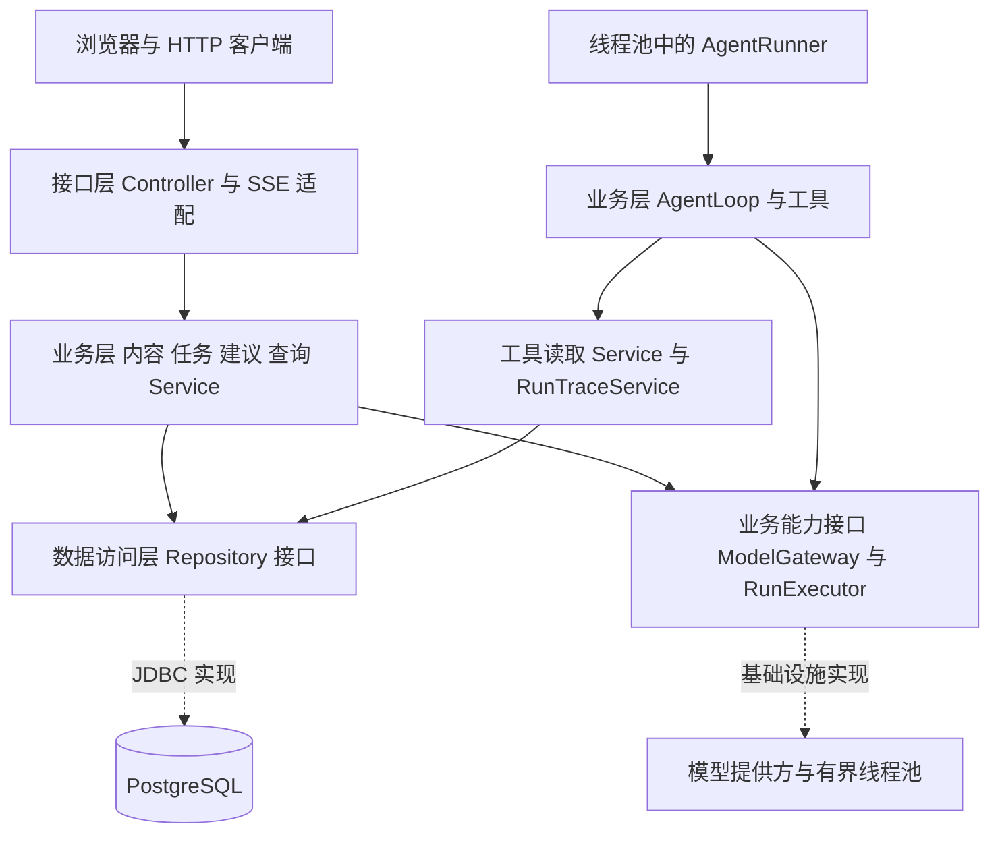

# 墨界后端三层架构与重构方案

**版本：** 0.1  
**日期：** 2026-10-01  
**状态：** 2026-10-02 已完成代码迁移；架构、事务、模型协议及 HTTP/SSE 回归见[实施验证记录](../verification/backend-three-layer-refactoring-2026-10-02.md)。  
**核查基线：** 当前仓库提交 `8d3119a` 的后端实现。  
**适用范围：** Java 21、Spring Boot、PostgreSQL 的现有内容管理、Agent 任务、建议审核与 HTTP/SSE 服务。

目标后端采用按业务模块组织的三层架构：接口层 Controller、业务层 Service、数据访问层 Repository。业务规则与事务由 Service 管理，SQL 与数据映射由 Repository 实现。Agent 循环属于业务层；线程池、模型客户端、数据库连接与迁移属于基础设施。基础设施实现业务层声明的接口，不作为第四个业务层。

本次重构保持现有 HTTP/SSE 协议、数据库结构和业务行为，以逐条业务链路迁移的方式建立职责边界。完成后，Controller 不接触 JDBC、Repository 实现和运行调度细节，Service 可以脱离数据库测试规则，数据库并发与原子性仍通过真实 PostgreSQL 验证。

## 1 设计依据与范围

设计依据为 [MVP PRD v0.3](../prd/MVP_PRD_v0.3.md)、[Agent 工具循环 PRD](../prd/Agent_Tool_Loop_PRD_v0.1.md)、[架构决策](../adr/MVP_ADR_v0.3.md)、[原框架设计](Framework_Design_v0.1.md)、[运行事务边界](runtime.md) 和当前源码。

原框架设计提出模块内部 `api / app / domain / infra` 分层及 MyBatis 方案，当前源码实际采用直接 JDBC，且没有落实完整的业务与持久化隔离。本文提出新的目标包结构，实施时以本文的三层边界替代原设计对应的包布局与持久化实现约定；其他产品规则继续遵循 PRD 和 ADR。实施前后都应区分目标设计与已实现状态。

本次范围包括内容管理、运行受理与查询、取消与终态处理、建议整稿及逐项审核、工具读取与搜索、执行轨迹和 SSE。继续保持单作者、单后端实例、两个执行线程与八个排队名额、服务重启不续跑的部署约束。

[连续对话与 Skill PRD](../prd/Conversation_and_Skills_PRD_v0.1.md) 是新增功能的待实施需求稿。三层设计为后续 `conversation`、`skill` 模块提供组织方式，本次不据此新增接口、表或脚本执行环境，也不把这些能力列为已实现。

## 2 重构前基线结构与需要解决的问题

| 当前代码 | 当前承担的职责 | 重构目标 |
| --- | --- | --- |
| `api.ContentController` | 内容路由、请求绑定，直接依赖 `JdbcContentService`；请求引用 `JdbcProposalReview.Review` | 拆分作品、章节、设定接口；依赖 Service 和接口 DTO |
| `content.JdbcContentService` | 作品、章节、设定、历史查询，校验、版本规则、事务和 SQL | 拆为业务 Service 与内容 Repository |
| `api.AgentController` | 系统状态、任务、事件、建议接口；直接依赖调度器和 JDBC 查询；执行数据库健康 SQL | 按系统、任务、事件、建议拆分接口，统一经 Service 调用 |
| `agent.runtime.RunScheduler` | 受理编排、执行器、运行句柄、取消、超时、终态补偿、迁移与启动清理；自行创建 JDBC 类 | 拆分任务业务流程、运行资源和启动流程，通过构造器装配 |
| `agent.run.infra.JdbcRunAdmission / JdbcRunLifecycle / JdbcRunTerminalStore` | SQL 与事务，同时处理幂等、状态规则和成功校验 | 规则进入 Service；锁定读取、条件更新和记录写入进入 Repository |
| `agent.run.infra.JdbcRunQuery` | 任务快照、事件、开发轨迹与建议详情，游标规则和数据映射 | 拆为查询 Service 与相应 Repository；建议查询归入 proposal |
| `proposal.infra.JdbcEditProposalService / JdbcProposalReview` | 建议状态规则、差异项校验、正文更新和 SQL | 建议业务与差异算法进入 Service/model；持久化进入 Repository |
| `agent.trace.infra.JdbcLoopTrace` | 循环轨迹适配、预算预留、有效性检查、消息与事件原子写入 | `RunTraceService` 实现循环轨迹接口，编排短事务和 Repository |
| `agent.tool.ContentRepository / infra.JdbcContentRepository` | 工具读取契约，历史读取、一致视图及视图落库 | 工具依赖只读业务接口；业务 Service 编排内容读取与视图 Repository |
| `agent.run.infra.RunEventStream` | Spring MVC SSE、连接容量、线程池、数据库跟读 | 移至接口层 SSE 适配，依赖事件查询 Service |
| `api.ApiErrors` | 将 JDBC 实现中的异常映射为 HTTP | 使用稳定业务错误类型，不依赖 JDBC 类 |

已有隔离应保留：`AgentLoop` 通过 `ModelGateway`、`AgentTool`、`LoopTrace` 工作；工具上下文按 Run 独立创建。这些边界可以继续使用，重构不要求重写循环算法或提供方协议。

迁移后的主要源码入口为 [章节业务](../../backend/src/main/java/com/mojie/content/service/ChapterService.java)、[任务接口](../../backend/src/main/java/com/mojie/agent/api/AgentRunController.java) 和 [运行业务入口](../../backend/src/main/java/com/mojie/agent/service/RunService.java)。源码中的最新审核逻辑优先于尚未同步的旧运行文档描述。

## 3 三层职责与依赖

### 3.1 接口层

接口层使用 `api` 包，负责路由、请求绑定、参数格式校验、请求 DTO 与业务命令转换、响应 DTO、HTTP 状态码、异常映射与 SSE 传输。作者身份通过注入的 `ActorProvider` 获取，继续使用当前配置作者，不增加多用户认证。

Controller 每个业务入口调用一个相应 Service。业务权限、资源归属、版本匹配和状态转换在 Service 中再次校验，不能仅依赖接口注解。接口层不执行 SQL，不创建调度器，不管理数据库事务。

SSE 适配属于接口层，其定时与发送线程由 Spring 管理的 Bean 持有。`RunEventStream` 可以调用 `RunEventQueryService` 读取已提交事件，但不能直接依赖 Repository。传输层保留连接上限、游标解析、心跳和连接释放逻辑。

### 3.2 业务层

业务层使用 `service` 包，负责校验、权限与归属检查、业务规则、跨资源编排、短事务、幂等流程和状态转换。Agent 循环、工具规则、搜索匹配、建议差异计算均为业务层中的算法或协作者。

Service 依赖 Repository 接口及业务所需的外部能力接口，例如 `ModelGateway`、`RunExecutor`、`RuntimeStatus`。普通 Service 使用具体类，不为每个类机械增加 `Service` 与 `ServiceImpl`；只有实际需要替换或隔离实现的边界才定义接口。

业务 Service 可以使用 Spring 的事务设施，但循环算法与工具契约继续不依赖 Spring、JDBC、HTTP 和基础设施实现。长时间任务的编排方法不打开覆盖整个执行期的数据库事务。

### 3.3 数据访问层与基础设施

数据访问层使用 `repository` 包定义接口，`repository.jdbc` 包实现 SQL、行映射、锁定读取、条件更新、批量读写和数据库超时。查询返回有类型的 record，写入返回受影响行数或明确的写入结果，不返回 JDBC 对象。

Repository 可以提供 `lockProject`、`findForUpdate`、`updateIfVersionMatches`、`appendEvent` 等数据库操作。它不决定是否允许采纳、如何分类任务终态，也不自行将业务结果转换为 HTTP 状态。

线程池、模型 HTTP 客户端、Flyway 与事务执行器等实现放在 `infrastructure`。它们属于三层框架的技术支撑，依赖业务层声明的接口。通过接口回调业务流程是允许的；Service 不导入这些实现类。启动装配放在 `config`，只有装配代码连接 Service 与具体实现。

### 3.4 调用关系



代码的依赖方向为 `api → service → repository 接口`，Repository JDBC 实现与其他基础设施通过配置注入。`model` 存放共享 record、enum 和纯规则，不提供独立调用层；禁止 Controller 通过模型中的方法绕过 Service 访问数据库。

## 4 目标包结构

以下列出主要类，DTO 和 record 可根据实际签名补充。每个业务模块内部保持相同的三层命名。

```text
com.mojie
├── MojieApplication
├── config/
│   ├── ContentConfiguration
│   ├── AgentConfiguration
│   ├── TransactionConfiguration
│   └── StartupLifecycle
├── common/
│   ├── error/                 # BusinessException、ErrorCode、StorageException
│   ├── web/                   # ApiExceptionHandler、响应封装、ActorProvider
│   ├── pagination/            # Page、PageCursor
│   └── transaction/           # TransactionRunner 接口
├── content/
│   ├── api/                   # ProjectController、ChapterController、SettingController、DTO
│   ├── service/               # ProjectService、ProjectAccessService、ChapterService、SettingService
│   ├── model/                 # Project、Chapter、ChapterRevision、Setting、命令与查询结果
│   └── repository/
│       ├── ProjectRepository、ChapterRepository、RevisionRepository、SettingRepository
│       └── jdbc/              # JdbcProjectRepository 等实现及 RowMapper
├── agent/
│   ├── api/                   # AgentRunController、RunEventController、dto、sse/RunEventStream
│   ├── service/
│   │   ├── RunService、RunAdmissionService、RunQueryService、RunLifecycleService
│   │   ├── RunCompletionService、RunTraceService、RunEventQueryService
│   │   ├── AgentRunner         # 一次执行的业务编排
│   │   ├── loop/              # AgentLoop、LoopInput、LoopOutcome、LoopTrace、LoopLimits
│   │   ├── tool/              # AgentTool、ContentTools、ToolContext、ToolContentService
│   │   └── port/              # ModelGateway、RunExecutor、RuntimeStatus
│   ├── model/                 # Run、RunStatus、RunSnapshot、RunEvent、运行命令与结果
│   └── repository/
│       ├── RunRepository、RunReadRepository、RunTraceRepository
│       ├── RunEventRepository、ChapterViewRepository
│       └── jdbc/              # 各接口的 JDBC 实现
├── proposal/
│   ├── api/                   # ProposalController、审核请求 DTO
│   ├── service/               # ProposalService、ProposalReviewService、ChapterSaveCoordinator
│   ├── model/                 # EditProposal、ReviewChoice、ReviewResult、ProposalDiff
│   └── repository/
│       ├── ProposalRepository、ProposalRevisionRepository
│       └── jdbc/
├── system/
│   ├── api/                   # SystemController
│   ├── service/               # HealthService、CapabilityService
│   ├── model/                 # HealthStatus、Capabilities
│   └── repository/            # DatabaseProbe 接口与 jdbc/JdbcDatabaseProbe
└── infrastructure/
    ├── transaction/           # SpringTransactionRunner
    ├── runtime/               # BoundedRunExecutor、RunRegistry、RunHandle、TimeoutSweeper
    ├── model/anthropic/       # AnthropicModelGateway
    └── model/openai/          # ChatCompletionsModelGateway
```

包迁移可以分阶段完成。循环、模型契约和工具的旧包路径在行为迁移期间允许保留，最终移到上述路径，并同步测试与源码链接。不要为先完成目录改名同时改写循环逻辑。

跨模块依赖保持单向：`proposal.service → content.service`；Agent 工具经 `ToolContentService` 使用内容只读能力；系统 Service 使用 `RuntimeStatus`。`content.service` 不反向依赖 `proposal.service`，也不依赖 Agent runtime。

章节路由同时支持普通保存和带建议决策的保存，因此 `content.api.ChapterController` 可以调用 `proposal.service.ChapterSaveCoordinator`。这是明确的业务入口依赖，不让内容业务层反向引用建议模块。协调器负责一笔保存事务，内容 Service 负责正文与历史规则。

## 5 主要业务服务与接口契约

| 业务服务 | 对外职责 | 主要依赖 |
| --- | --- | --- |
| `ProjectService / SettingService` | 作品与设定 CRUD、分页、运行期间的变更限制 | 内容 Repository、ProjectAccessService |
| `ChapterService` | 章节 CRUD、版本校验、正式正文与历史写入、历史读取 | ChapterRepository、RevisionRepository、ProjectAccessService |
| `ChapterSaveCoordinator` | 一次保存中协调正文、逐项审核和版本关联 | ChapterService、ProposalReviewService、ProjectAccessService |
| `ProposalService` | 建议详情、整稿接受与拒绝、状态校验 | ProposalRepository、ChapterService、ProjectAccessService |
| `RunService` | 提交、取消的入口编排；连接数据库状态与本地执行资源 | RunAdmissionService、RunLifecycleService、RunExecutor |
| `RunAdmissionService` | 规范化输入、幂等摘要、任务受理事务、基准与配置快照 | RunRepository、内容读取与项目锁能力 |
| `RunQueryService` | 作者范围的列表、详情、一致快照与开发轨迹 | RunReadRepository、RunTraceRepository |
| `RunLifecycleService / RunCompletionService` | 开始、取消、超时、重启清理；终态仲裁与成功校验 | RunRepository、RunTraceRepository、ProposalRepository、RunEventRepository |
| `RunTraceService` | 实现 LoopTrace；预算预留、消息引用、步骤与证据原子记录 | RunTraceRepository、RunRepository、RunEventRepository |
| `ToolContentService` | 工具只读入口、固定版本读取、一致视图及搜索读取 | 内容只读 Service、ChapterViewRepository |
| `RunEventQueryService` | 归属检查、按序号查询已提交事件 | RunReadRepository、RunEventRepository |
| `HealthService / CapabilityService` | 数据库与运行状态聚合、公开能力查询 | DatabaseProbe、RuntimeStatus、注入配置 |

接口示例仅展示边界，实施时需补齐现有路由、字段与异常分支：

```java
// content.model：不引用 JDBC 或 HTTP 类型。
public record SaveChapterCommand(
        String ownerId, String chapterId, String content, int expectedVersion) {}

// proposal.model：与逐项审核 HTTP DTO 分开定义。
public record SaveChapterWithReviewsCommand(
        SaveChapterCommand chapter, List<ProposalReviewCommand> reviews) {}

// content.repository：SQL 与版本条件更新的契约。
public interface ChapterRepository {
    Chapter findOwned(String ownerId, String chapterId);
    Chapter findForUpdate(String ownerId, String chapterId);
    int updateContentIfVersionMatches(
            String chapterId, int expectedVersion, String content);
}

// proposal.service：承担跨模块的单次保存事务。
public final class ChapterSaveCoordinator {
    public ChapterSaveResult save(SaveChapterWithReviewsCommand command) {
        return transactions.required(() -> saveInTransaction(command));
    }
}

// agent.service.port：受理预留名额与实际执行分开。
public interface RunExecutor {
    Reservation reserve();
    void schedule(Reservation reservation, RunExecution execution);
    void signalCancel(String projectId, String runId);
}
```

`Reservation` 应有明确的转交和一次释放语义：数据库创建失败或幂等重检命中时由调用方释放；成功调度后由运行句柄负责释放；排队取消和调度拒绝各自只释放一次。`AgentRunner` 不依赖 `RunService`，而使用生命周期、轨迹、读取和终态 Service，避免构造器循环依赖。

数据访问异常由 Repository 转为 `StorageException`，保留内部原因和必要的 SQLState 分类。Service 将特定约束竞争转为业务结果；HTTP 响应不得携带 SQL、连接配置或模型密钥。业务错误类型从原有 JDBC 类的内部异常中抽出，继续保持已有 `code` 和状态映射。

系统接口继续保持当前语义：数据库可用而运行资源降级时，health 返回 HTTP 200 和 `DEGRADED`；数据库不可用返回 503。模型未配置、任务容量超限和 SSE 容量超限分别沿用当前 503、409 和 429 映射，不在分层过程中统一改成另一种状态码。

## 6 事务与并发规则

### 6.1 事务机制

沿用 Spring JDBC 技术栈，使用 `JdbcTemplate` 或通过 `DataSourceUtils` 获取受 Spring 事务管理的连接。使用 `TransactionTemplate` 实现注入的 `TransactionRunner`，至少提供 `required`、独立新事务和只读 REPEATABLE READ 的执行方式。

Service 显式包围需要原子提交的短流程。Repository 加入当前事务，不自行 `commit`、`rollback` 或 `setAutoCommit`。跨模块参与同一保存流程的 Service 使用 REQUIRED 语义加入同一事务，不能用 REQUIRES_NEW 把章节历史、审核决定或事件提前提交。

已有手写连接事务在迁移前可以保留；同一链路切换到 Spring 事务时必须一并迁移参与者。不得在外层加事务注解后继续用 `dataSource.getConnection()` 创建独立事务，宣称两者已经原子化。所有资源使用同一个 DataSource 与事务管理器。

只读一致快照使用独立、短的 REPEATABLE READ 事务，明确选择隔离级别，防止加入既有 READ COMMITTED 事务后失去一致性。项目现有普通读取不要求全部升级为 REPEATABLE READ。

### 6.2 必须保留的原子提交

| 流程 | 事务内步骤 | 事务外步骤或提交后动作 |
| --- | --- | --- |
| 普通章节保存 | 作者归属、项目及章节锁、版本检查、内容条件更新、不可变历史插入 | 转换 HTTP 响应 |
| 章节与逐项审核保存 | 项目锁、建议及章节锁、决策校验、正文与历史更新、审核决定与版本关联 | 返回新的正文及审核状态 |
| 整稿采纳 | 项目 → 建议 → 章节锁、基准版本检查、正文与 AGENT 历史、建议状态 | 根据结果返回 200 或 409 |
| 任务受理 | 项目锁、幂等重检、活动槽及章节版本校验、任务/基准/配置/初始消息/排队事件/活动槽 | 登记完整句柄后入执行队列 |
| 模型开始记录 | 锁 Run、输入引用校验、预算预留、调用记录与开始事件 | 请求模型 |
| 模型结束记录 | 有序完整内容块、调用结果、消息序号与结束事件 | 循环继续处理响应 |
| 工具结束记录 | 步骤结果、实际回复消息、证据、文本预算与事件 | 将已经持久化的回复用于下一次模型请求 |
| 终态提交 | 项目 → Run 锁、终态仲裁、最终输入校验、可选建议发布、关闭未完成记录、终态事件、条件释放活动槽 | 本地句柄完成清理 |
| 章节视图固定 | 先在短只读一致事务获取 ID/顺序/版本，再在独立短写事务锁 Run 并保存固定版本 | 扫描不可变历史正文 |

事务内不调用模型、不发送 SSE、不等待线程退出，也不扫描全书正文。工具快照必须落库成功后才能供搜索使用；失败不得返回部分结果。轨迹持久化失败后循环停止，不能继续发起模型请求。

### 6.3 锁顺序与版本

跨资源写操作统一为 `project → run 或 proposal → chapter`；同时涉及多个建议时按稳定 ID 顺序加锁。仅锁 Run 的轨迹事务不随后请求 project 锁，防止与终态事务构成反向锁等待。

事件 seq、消息 message_seq 的分配仍在 Run 行锁下完成，并与相应记录一起提交。已经返回给循环的消息序号必须对应已提交消息；没有实际返给模型的工具结果不能进入后续调用的输入序号集合。

当前 `saveChapter` 在项目锁后先锁章节、再锁建议；整稿采纳则先锁建议、再锁章节。两者当前通过同一项目锁串行化。重构章节审核链路时统一为项目、建议、章节顺序，避免将来拆分项目锁后引入死锁。该调整应与并发用例一起验证，不假设已有死锁事故。

章节更新保留 expectedVersion 条件；受影响行数不为一时不能按成功继续插入历史。正文相同且没有其他正文变化时不增加章节版本或重复写历史，但合法的新审核决定仍需保存。历史中的 `MANUAL`、`AGENT`、`MIXED` 来源和多建议版本关联保持现有语义。

整稿采纳遇到基准版本不匹配，必须先提交 `CONFLICTED` 决定再返回 HTTP 409。使用返回值表达该结果；不要在同一事务中抛出会回滚的业务异常，从而丢失冲突状态。逐项审核的非法或冲突决定则与本次正文保存一起回滚。

### 6.4 幂等与终态

受理先查幂等记录，再预留本地容量，事务中加项目锁后重检。相同键相同内容返回原任务，不占用额外名额；相同键不同内容继续返回 `IDEMPOTENCY_CONFLICT`。唯一约束竞争必须结束并回滚失败事务后，在新事务读取已存在记录。

`RunService.submit` 本身不持有覆盖容量预留与调度的事务。受理提交后再登记句柄、调度；执行器拒绝时，通过终态 Service 提交 `SCHEDULING_FAILED` 并清理匹配槽。终态存储暂不可用时保留待补偿任务、降低就绪状态，恢复后重新读取并提交，不能直接丢弃身份。

终态优先检查已经提交的结果；未终结时沿用取消、截止时间、失败与成功的仲裁顺序。成功仍须验证完整目标章回复进入最后模型调用的实际输入引用。只有成功事务可以将内存候选发布为建议，失败或取消不能发布。

运行读取使用受理时保存的系统提示、工具 schema、模型配置、上下文窗口和章节基准，不重新读取当前配置替换快照。两种模型适配器保留完整提供方内容，包括续接需要的 opaque 字段；开发轨迹接口继续脱敏。现有调用预算、截止时间与工具顺序执行规则保持不变。

活动槽按 `active_run_id = 当前 runId` 条件释放，迟到的旧任务不能清除新任务槽。提交响应丢失后重试终态应返回已提交结果，不能把已有成功覆盖为失败。终态补偿只修复持久状态，不重新请求模型。

### 6.5 本地运行资源

`BoundedRunExecutor` 保留两工作线程、八排队位置和十个受理许可。句柄先完整登记再提交执行；排队取消移除任务并释放一次；运行中取消只发出取消信号，许可等实际工作线程退出后释放，不能因 Future 已取消就提前计为空闲。

`TimeoutSweeper` 每两秒调用生命周期 Service 更新数据库，再通知匹配的本地句柄，并重试待补偿终态。启动流程按 Flyway 迁移、旧进程任务清理、启用扫描与执行资源、开放就绪的顺序执行；失败时不接收任务。不要让线程池组件自行创建 JDBC Repository 或执行迁移。

## 7 典型调用流程

### 7.1 保存章节并记录逐项审核

1. `ChapterController` 将正文、expectedVersion 和审核 DTO 转为 `SaveChapterWithReviewsCommand`。
2. `ChapterSaveCoordinator` 校验命令格式并打开一次短事务，通过 `ProjectAccessService` 校验归属并锁项目。
3. `ProposalReviewService` 锁定相关建议；`ChapterService` 锁定章节并校验版本。建议差异项和状态规则由业务层判断。
4. 内容变化时更新正文并插入一个新历史版本；保存审核决定及其版本关联。任何非法决定导致整笔事务回滚。
5. 提交后返回有类型的保存结果，由接口层映射为现有 JSON。

普通保存使用同一协调入口，reviews 为空时只执行内容规则。内容 Service 不需要知道建议审核请求结构，也不直接调用建议 JDBC 工具。

### 7.2 创建与执行 Agent 任务

1. `AgentRunController` 获取配置作者，调用 `RunService.submit`；模型配置与运行就绪由业务入口检查。
2. 查幂等记录、预留许可；`RunAdmissionService` 执行受理事务并返回 receipt。重检命中已有任务则归还许可。
3. `RunExecutor` 登记完整句柄后调度 `AgentRunner`；后者经 `RunLifecycleService` 认领，再读取受理时的快照。
4. 每次运行创建独立 `ToolContext` 和循环工作状态。`AgentLoop` 使用模型、工具与轨迹接口推进；数据库事务之间执行模型请求。
5. `RunCompletionService` 仲裁并提交结果；工作线程最终退出时清理本地身份和许可。数据库提交失败交由既有补偿语义处理。

### 7.3 SSE 查询与恢复

1. `RunEventController` 解析 Last-Event-ID 与 afterSeq，沿用当前优先级及非负校验，经 Service 检查资源归属。
2. `RunEventStream` 预留连接名额，每 500 ms 调用事件查询 Service，单批最多 100 条，只发送已提交事件。
3. 发送在独立的有界线程中执行，每连接最多一个在途批次；保持总计 20 条连接限制，第 21 条返回现有 429 错误。
4. 断线和终态释放连接名额一次；客户端依据 runId 与 seq 去重并继续回放。SSE 发送失败不取消 Agent 任务。

## 8 旧类到新职责的迁移

| 旧类或能力 | 新业务入口 | 新持久化或技术实现 |
| --- | --- | --- |
| `JdbcContentService` 作品部分 | ProjectService、ProjectAccessService | JdbcProjectRepository |
| `JdbcContentService` 章节及历史部分 | ChapterService、ChapterSaveCoordinator | JdbcChapterRepository、JdbcRevisionRepository |
| `JdbcContentService` 设定部分 | SettingService | JdbcSettingRepository |
| `JdbcRunAdmission` | RunAdmissionService | JdbcRunRepository，以及内容锁定读取能力 |
| `JdbcRunLifecycle` | RunLifecycleService | JdbcRunRepository、JdbcRunEventRepository |
| `JdbcRunTerminalStore` | RunCompletionService | Run/Trace/Proposal/Event Repository 的同一事务写入 |
| `JdbcRunReader` | AgentRunner 使用的内部快照读取能力 | JdbcRunReadRepository |
| `JdbcRunQuery` 任务及轨迹部分 | RunQueryService | JdbcRunReadRepository、JdbcRunTraceRepository |
| `JdbcRunQuery` 建议与事件部分 | ProposalService、RunEventQueryService | JdbcProposalRepository、JdbcRunEventRepository |
| `JdbcLoopTrace` | 实现 LoopTrace 的 RunTraceService | JdbcRunTraceRepository、JdbcRunEventRepository |
| 工具侧 `ContentRepository / JdbcContentRepository` | ToolContentService 及只读接口 | 内容 Repository、JdbcChapterViewRepository |
| `JdbcEditProposalService` | ProposalService | JdbcProposalRepository；正文经 ChapterService 写入 |
| `JdbcProposalReview` | ProposalReviewService；HTTP 审核类型移至 DTO，业务类型移至 model | JdbcProposalRepository、JdbcProposalRevisionRepository |
| `ProposalDiff` | 保留纯算法，移至 proposal.model | 不访问数据库 |
| `RunScheduler` | RunService、AgentRunner、RunLifecycleService、RunCompletionService | BoundedRunExecutor、RunRegistry、TimeoutSweeper、StartupLifecycle |
| `RunEventStream` | RunEventQueryService 提供数据 | 接口层 SSE Bean，独立有界传输资源 |
| 两种模型 Gateway 实现 | 继续实现 ModelGateway | infrastructure.model 中的协议适配器 |
| `ApiErrors` | 稳定业务错误类型 | common.web.ApiExceptionHandler |
| `MojieApplication` 内集中装配 | 不承载业务规则 | config 中按职责拆分 Bean 和启动生命周期 |

迁移时不是把旧 `Jdbc*Service` 原样改名为 Repository 再增加一层转发。每条链路都需要识别业务判断、事务编排和 SQL，分别落实到对应职责。复合查询可以继续使用 JOIN 和专用查询结果，不为追求实体划分拆成大量往返查询。

## 9 分阶段实施与完成条件

各阶段独立形成可审查的提交，保持可运行。一次阶段只切换一组完整链路；旧、新实现可以短期并存，但同一请求只使用一套实现，不双写数据库。

| 阶段 | 实施内容 | 完成条件 |
| --- | --- | --- |
| R0 行为基线 | 确认专用测试库，记录现有 HTTP/SSE 样例、错误映射、JSON 字段、事务与并发测试结果 | 形成基线记录；已有失败与跳过单独标注 |
| R1 公共边界 | 抽出业务异常、record、作者配置和事务执行器；建立 ArchUnit 规则与精确遗留清单 | 新代码遵守边界；事务设施在真实 PG 验证回滚和传播 |
| R2 内容链路 | 按作品、设定、章节与历史迁移；涉及审核的保存与 R3 一起切换 | 内容读写、分页、历史、冻结规则和 HTTP 往返保持兼容 |
| R3 建议链路 | 抽出建议规则与 Repository，迁移整稿采纳、拒绝和 ChapterSaveCoordinator | 逐项保存、编辑建议、来源关联、版本冲突、并发和整体回滚通过 |
| R4 任务查询与事件 | 拆分任务、建议查询和事件 Service；移动 SSE 适配；系统检查经 Service | 快照一致性、脱敏、事件序号、连接容量和回放通过 |
| R5 任务执行与持久化 | 拆分受理、生命周期、轨迹、终态和本地执行资源；迁移工具快照与读取 | 幂等、2+8 容量、取消、超时、补偿、候选发布和输入引用全部通过 |
| R6 收尾 | 完成包迁移、移除旧类与遗留豁免，收拢启动配置并同步文档 | 全部架构规则无豁免；回归完成；旧路径与装配入口清理完毕 |

R2 与 R3 的章节审核入口必须作为同一迁移单元验收。R5 可拆成多个提交，但每个提交仍保持完整的短事务及资源释放语义。复杂链路先迁移职责、再做目录调整，避免行为变化与路径变动混在一起难以审查。

无需修改现有 Flyway 表结构或引入 ORM、Redis、消息队列。Repository 接口定义需要的操作，不引入通用 CRUD 基类、通用状态机框架或完整 DDD 聚合体系。技术选型变化若另有需求，单独记录 ADR。

## 10 验证方案与验收标准

### 10.1 架构检查

在测试依赖中增加 ArchUnit，建立 `architecture.LayerRulesTest` 和 `architecture.ModuleRulesTest`。存量违规使用限定类名的遗留清单，并随阶段删除；不允许以忽略整个包的方式掩盖新增违规。

最终规则包括：

- api 及接口异常映射不依赖 repository、infrastructure、DataSource、JDBC 或运行资源实现。
- Service 不依赖 api、repository.jdbc 或 infrastructure 实现；不通过 SQL 字符串或 JDBC 对象访问数据库。
- Repository 接口不暴露 Connection、ResultSet、Spring MVC 类型；JDBC 实现不依赖 Controller 或业务 Service。
- `service.loop`、工具契约、共享 model 不依赖 Spring、JDBC 或基础设施实现。
- 提供方 SDK 只能出现在对应模型适配器；模型适配器不执行工具、不新增自动重试。
- 模块依赖无环，content.service 不依赖 proposal.service；正式正文写入只由 ChapterService 发起，并通过对应 Repository 完成。
- Service 不自行 new Repository 实现；业务句柄、模型客户端、线程池与启动资源均通过 config 装配。

ArchUnit 检查类型依赖与调用位置。事务提交、SQL 参数化、锁顺序、超时和释放次数还需要数据库与并发测试，不能仅凭包名或注解宣称通过。

### 10.2 行为回归

保留并迁移现有 `AgentLoopTest`、`ProposalDiffTest`、模型配置与协议测试、`JdbcContentServiceIT`、`JdbcContentRepositoryIT`、`RunSchedulerIT` 的有效断言。测试类可以改名，不删除复杂并发与故障用例来降低重构成本。

| 验证范围 | 必须证明的结果 |
| --- | --- |
| 内容与审核 | 同文保存不增版本；Unicode/换行无损；逐项及编辑后的建议保留；所有相关版本正确关联；非法审核与正文一起回滚 |
| 采纳与拒绝 | 重复采纳不重复历史；冲突状态提交后返回 409；部分采纳及拒绝保持状态规则；并发请求不重复更新 |
| 幂等与容量 | 重复提交不占新许可；同键异内容冲突；同作品只受理一个活动任务；两个执行、八个排队；拒绝不留下孤立 Run |
| 取消与超时 | 排队取消释放一次；运行取消等工作线程退出；超时可先结束数据库任务但不提前释放本地资源；旧执行不能释放新槽 |
| 原子性与恢复 | 事件插入失败回滚相关消息/步骤/证据/建议；连接恢复后终态补偿；提交响应丢失保留已成功结果；重启先清理再就绪 |
| 模型与工具 | 两种协议完整续接；预算和输入引用不丢；工具版本视图固定；搜索取消和数据库超时无部分证据；失败不发布候选 |
| 查询与 SSE | 详情与 lastEventSeq 来自一致读取；开发轨迹仍脱敏；分页游标绑定资源及筛选；第 21 条连接拒绝；重连补发与名额恢复 |
| HTTP 兼容 | 路由、方法、状态码、错误 code、data 封装、时间格式、空值省略规则和字段含义保持现状 |

测试使用专用可丢弃的真实 PostgreSQL 数据库，不能以 H2 或纯 mock 替代事务与锁行为验证。新增 Service 单测只覆盖有判断价值的规则；不为简单转发或 DTO 字段搬运编写镜像测试。

实施阶段的主要检查命令如下，数据库变量应通过本地测试配置注入，不将密码写入文档或提交：

```bash
# backend 目录，Java 21；包含拟新增的架构测试与现有单元测试。
mvn test

# backend 目录；配置 MOJIE_TEST_JDBC_URL、MOJIE_TEST_DB_USER、
# MOJIE_TEST_DB_PASSWORD 后运行真实 PostgreSQL 集成测试。
mvn verify

# backend 目录；启用本地模拟 HTTP 提供方，验证两种模型协议。
MOJIE_TEST_LOCAL_HTTP=1 mvn -Dtest=AnthropicModelGatewayIT,ChatCompletionsModelGatewayIT test

# web 目录；按仓库现有独立数据库与模拟模型配置运行。
npm run test:e2e
```

上述命令已在本次实施中执行，具体测试数、跳过数与 HTTP/SSE 核对见[实施验证记录](../verification/backend-three-layer-refactoring-2026-10-02.md)。日后回归仍须确认环境开关实际启用了集成测试；命令退出成功而数据库测试全部跳过不能作为验收。

分层重构主要通过本地模拟模型验收。只有实际改变模型输入或协议时，另行运行真实模型验证；文学质量、已有提供方超时和正式发布剩余验收不因重构通过而自动完成。

### 10.3 完成定义

全部现有路由使用新的三层入口；Controller 不接触 JDBC 或具体运行资源；业务规则、事务和 SQL 已分离；架构规则无遗留豁免；原有事务、资源、协议及故障断言继续通过；数据库测试无非预期跳过。

同时更新根 README、backend README、原框架设计的分层说明、运行事务文档、工程映射和失效源码链接。API 契约核对结果与测试记录保存在 `docs/verification/`，明确原有未通过项和本次新增问题。

## 11 风险与回退

最大风险是事务拆开、异步取消过早释放许可、终态重试覆盖已提交结果，以及 record 替换 Map 后改变 JSON。章节审核与任务执行阶段分别以原子性、并发和 HTTP 契约检查约束，不以“编译通过”作为完成标准。

数据库结构保持不变，每阶段保留可运行提交与回归记录。出现回归时回退完整阶段提交；不在同一请求中混用新旧事务或同时执行两套写入实现。服务仍按单实例启动，切换版本前停止旧实例并让新实例执行原有旧任务清理流程，不能通过并行启动两版服务验证生产写入。

未来连续对话模块沿用 `api / service / repository`，Skill 的包存储与脚本执行使用 Service 声明的能力接口及 infrastructure 实现。涉及会话顺序、文件与数据库一致性的新事务协议，应在该功能设计中补充，不由本次分层方案预先承诺。
