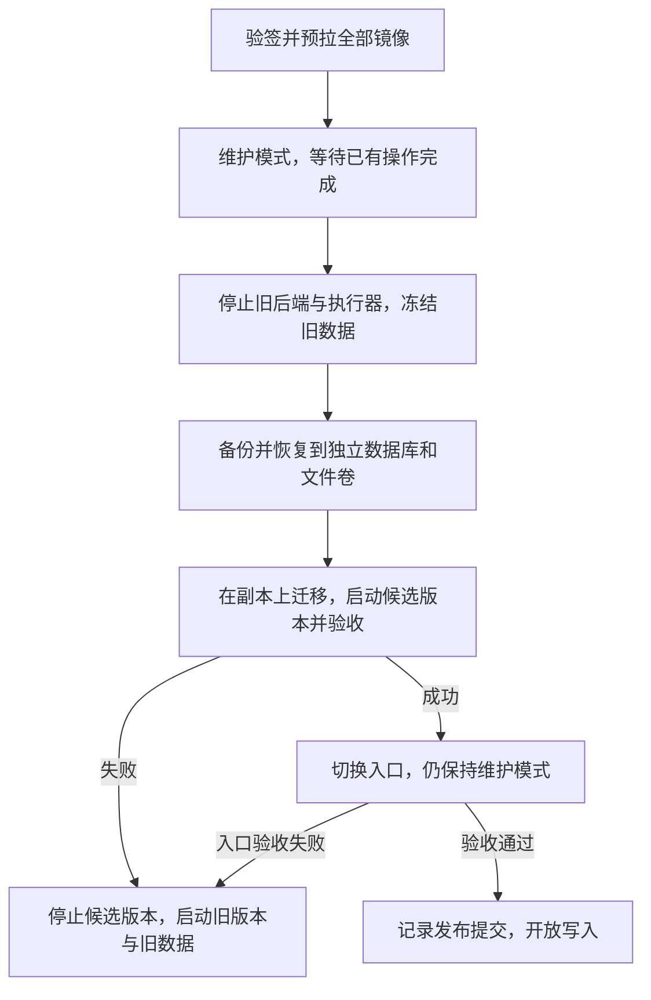

# 安全自动更新、迁移与失败回退方案

**状态：设计基线，首版代码已加入；生产服务器尚未安装或联调。** 本文基于 2026-10-10 的仓库实现，说明自动更新与失败回退的保证边界。维护模式、发布清单、独立入口与部署状态机的安装步骤见 [操作说明](safe-update-operations.md)，本地验证范围见 [实施验证记录](../verification/safe-update-and-maintenance-2026-10-10.md)。尚未接入自动更新的服务器仍按 [环境与部署方案](development-deployment-environment.md) 手动更新。

## 目标与保证边界

日常更新由服务器主动获取发布版本，无需人工登录 SSH，也无需在 GitHub 保存服务器登录密钥。SSH 本身是安全协议，这里的改进是减少登录操作、长期凭据和远程执行入口。

核心保证是：**新版本开放用户写入之前，更新或迁移失败可自动恢复旧环境，不丢失冻结时点前的已提交用户数据。** 这允许短暂维护中断，不保证零停机，也不保证继续执行已中断的 Agent 任务。

新版本开放写入后，旧数据不会自动同步新增章节、消息或文件。如果迁移不兼容旧应用，恢复发布前的数据就会丢失后续写入，因此不能自动执行这种回退。

## 实施前的基础与约束

下表记录本方案实施前的问题背景。首版已补齐统一验签清单、执行器健康检查、保持停止的备份、维护拦截、独立候选环境和持久化恢复；实际操作以 [操作说明](safe-update-operations.md) 为准。

| 当前实现 | 对发布与回退的影响 |
| --- | --- |
| [GitHub Actions](../../.github/workflows/images.yml) 测试后分别发布 backend、executor、web 镜像，标签为完整提交 SHA | 缺少三个镜像全部成功后的统一发布记录；同一 SHA 重跑可能覆盖标签，应使用 digest 锁定镜像 |
| [生产 Compose](../../deploy/compose.prod.yaml) 配置持久化卷及后端、Nginx 健康检查 | 有运行基础，但没有自动更新、部署锁或回退状态机；执行器还需要健康检查 |
| [后端启动流程](../../backend/src/main/java/com/mojie/config/StartupLifecycle.java) 执行 Flyway，并标记旧进程的活动任务失败 | 启动候选镜像就可能修改数据库，不能把启动视为无副作用的检查 |
| [V8 迁移](../../backend/src/main/resources/db/migration/V8__single_author.sql) 删除 owner_id，并聚合配额 | 属于破坏性变更；重新加列不能恢复原归属关系，需要迁移前数据 |
| [Skill 启动逻辑](../../backend/src/main/java/com/mojie/config/ConversationConfiguration.java) 执行恢复和维护 | 会修改上传、执行状态，并可能清理文件；数据库和文件卷必须一起保护 |
| [备份脚本](../../scripts/backup-conversation-skills.py) 停止写服务后导出数据库和文件，随后在 finally 中启动服务 | 部署使用时需支持备份后保持停止，否则冻结结束后会重新产生写入 |
| 当前单实例启动会把未完成 Run 标记为 SERVICE_RESTARTED | 更新前需等待任务完成；不适合直接套用多副本滚动更新 |

`restart: always` 只负责容器重启，不会获取新镜像。Watchtower 追踪 `latest` 无法完整处理多个镜像协同、数据库迁移和活动任务，不作为本项目的默认发布方式。

## 自动更新入口

采用 **GitHub Actions + 签名发布清单 + systemd timer + 固定本地部署程序**。

1. 推送 `main` 后执行现有测试与镜像构建。
2. 增加一个依赖整个构建矩阵成功的发布 job，只有三个镜像全部完成才发布统一清单。
3. 首版清单包含发布标识、提交 SHA、三个镜像 digest 和 `deploymentContract: 1`。迁移兼容性由固定部署程序的验收约束控制，尚不支持清单声明后跳过副本迁移。
4. 服务器每隔 1～5 分钟通过 HTTPS 检查发布记录，验证来源和版本策略，再进入部署流程。
5. 部署完成或失败后保存本地结果与日志。失败版本停止自动重试，直到显式重试或发布修复版本。

服务器无需新增公网 webhook 或部署端口。生产密钥留在服务器；私有镜像使用权限范围尽量小的只读拉取凭据。

首版采用 GitHub artifact attestations，通过 GitHub CLI 验证指定仓库、发布工作流、`main` 分支、源码 SHA 和 GitHub 托管 runner，并限制镜像仓库名称。部署按 `image@sha256:…` 拉取。清单不得提供任意 shell 命令，不得自动下载仓库脚本并以 root 执行。部署程序及涉及宿主机权限的 Compose 变更需单独受控更新。

签名证明发布来源，不证明迁移或应用行为正确；仍需要以下隔离、备份和验收流程。Docker 访问权限通常接近宿主机 root 权限，部署程序和现有挂载 Docker socket 的执行器都属于需要保护的可信组件。

## 推荐发布流程：在独立副本上迁移

保留旧环境的镜像、配置、数据库卷和文件卷。停止旧环境的写入后，从同一个冻结时点生成候选数据，在候选环境上执行迁移并启动新版本。验证通过后切换入口，最后开放写入。

这是两套隔离环境之间的发布切换，**任何时候只能有一套环境接受用户写入**。候选验证不能与仍有生产写入的旧环境并行，否则切换时可能遗漏旧环境的新增数据。

### 1. 准备发布

验签、校验清单和配置、检查磁盘空间，并预拉全部应用镜像及必需运行时镜像。保存旧镜像 digest、Compose 配置、环境配置版本和实际卷标识；保留稳定的 `MOJIE_CURSOR_KEY` 等生产配置。密钥不进入公开清单或普通日志。

此阶段失败不改变运行环境。不要先停服务再等待镜像下载，也不要在镜像不齐时部署部分组件。

### 2. 阻止新写入并排空已有操作

维护模式必须覆盖章节保存、建议采纳、对话提交、Skill 上传等所有新写入，不能只暂停 Agent。等待已进入的请求、排队与运行任务、上传和脚本执行结束；超时则推迟发布。

只有查询“当前没有任务”不够，需要先关闭新操作入口，避免查询后又进入任务。客户端应提示维护状态并保留未保存草稿。

随后停止后端和执行器，确认相关子容器及后台写入结束。数据库和文件卷的其他外部写入也必须被排除，才能建立冻结时点。

### 3. 生成可恢复的数据副本

改造现有协调备份脚本，支持备份后保持服务停止，并由部署程序决定恢复旧环境还是继续发布。导出数据库、Skill 包和产物，保存清单、大小及哈希；全部成功后才生成备份完成标记，半成品不能作为恢复依据。

通过 `pg_dump` / `pg_restore` 恢复到独立空数据库，并把文件归档恢复到独立文件卷。不要直接复制运行中的 PostgreSQL 数据目录。数据库与文件必须来自同一个冻结时点。

候选环境使用独立 Compose project、数据库卷、文件卷和执行器工作目录。不得共享旧文件卷；执行器工作目录必须不同，避免启动清理影响另一环境。数据库版本升级需另行验证，不与普通应用更新混为一谈。

保留旧数据卷作为快速回退依据，同时保留独立备份。两份数据都在同一宿主机并不能防护宿主机磁盘故障，定期备份仍需有独立存储和恢复演练。

### 4. 在候选环境上迁移和验收

迁移仅连接候选数据库。可以先复用新应用的启动迁移，后续考虑拆成单次迁移入口，便于单独记录迁移结果；两种方式都不能让候选应用访问旧数据。

验收至少包含：

- 数据库实际恢复成功，Flyway 历史和迁移结果符合预期。
- 文件通过 [清单校验脚本](../../scripts/verify-skill-files.py) 的路径、大小和哈希检查。
- 后端响应中的 `status` 为 `UP`，执行器健康，前端及经代理的 API 可用。健康接口可能返回 HTTP 200 和 `DEGRADED`，只检查 HTTP 状态码不够。
- 已有章节、对话、固定 Skill 版本和有效产物能读取，关键计数及业务关系符合冻结时点的数据。
- 写入检查使用专用测试数据，并验证读取结果；不调用真实模型或触发外部副作用。

候选启动会执行恢复和文件维护，这些影响限制在候选副本内。健康检查通过不能替代业务验收。现有 [恢复检查脚本](../../scripts/check-skill-restore.py) 主要检查恢复和文件，并未实现生产切换或完整 API 恢复验收。

### 5. 切换入口并提交发布

增加独立于应用版本的稳定入口代理，将其上游指向当前环境。候选环境验收通过后切换上游，仍保持维护模式，验证实际用户入口、静态资源和 API。入口检查失败时切回旧环境。

入口检查成功后，先持久化“发布已提交，之后可能产生新写入”的记录，再开放用户写入。该顺序即使造成保守判断，也不能把已经接受写入的版本误认为可无损切回旧数据。

旧环境保持停止，在回退保留期内保留镜像、配置和数据。旧数据不自动同步新写入，不应被误认为开放写入后的实时备用库。

## 按失败阶段选择回退策略

| 失败位置 | 处理方式 | 数据影响与条件 |
| --- | --- | --- |
| 镜像下载、验签或准备失败 | 放弃本次更新，旧环境继续运行 | 无数据变化 |
| 维护排空超时 | 退出维护并推迟发布 | 不强制中断任务 |
| 备份或候选恢复失败 | 放弃候选环境，恢复旧服务 | 旧数据未被迁移，可能有维护中断 |
| 候选迁移失败 | 停止候选服务，保留失败现场，启动旧环境 | 不需要逆向 SQL，也不需要覆盖旧数据 |
| 候选启动或业务验收失败 | 启动旧镜像连接旧数据库和旧文件卷 | 尚未开放新写入，可恢复发布前状态 |
| 切换入口后、开放写入前验收失败 | 保持维护，停止候选服务并切回旧环境 | 用户新增写入尚未进入候选环境 |
| 开放写入后失败，旧应用兼容当前数据库、文件和新数据 | 使用当前数据回退应用 | 必须事先验证兼容性，不能接回冻结的旧数据 |
| 开放写入后失败，旧应用不兼容当前数据 | 进入维护，保留当前数据，优先修复；必要时制定恢复及新增数据处理方案 | 不能自动恢复旧备份，否则丢失新增写入 |

失败候选环境应保留必要日志和数据供排查，不立即执行 `down -v`。旧环境回退后也要完成健康和业务检查，检查成功才重新开放入口。如果旧环境无法启动，保持维护并报告故障，不能把回退命令执行完当作恢复成功。

## Flyway 事务不能代替发布回退

当前 PostgreSQL SQL 迁移大多可在事务中执行，一份迁移失败时通常可以回滚该份迁移。但 [Flyway 创建位置](../../backend/src/main/java/com/mojie/config/AgentConfiguration.java) 未配置整批迁移共用一个事务，不能假定整个版本升级会全部回滚。

例如从 V7 升到 V9，V8 成功提交而 V9 失败，数据库可能已经处于 V8。后端启动后的任务状态修改和文件清理也不属于迁移事务。

开启批量事务可以减少某些 SQL 失败的影响，但需要核对所有迁移是否支持事务，并评估锁持有时间；它仍不能回滚应用行为和文件操作。因此优先用候选副本保护旧环境。

不得通过删除 Flyway 历史、执行 `repair`、修改已应用迁移或关闭校验来假装退回旧版本。V8 删除字段并聚合数据后，反向加列不足以恢复原数据。

## 开放写入后的兼容性策略

今后的结构变更尽量分阶段发布：

1. 新增结构，保留旧字段，让旧应用继续工作。
2. 新应用兼容新旧结构，完成数据转换并验证一致性；必要时双写，明确处理失败与补偿。
3. 经过应用回退保留期后，再单独发布删除旧结构的变更。

是否兼容不能只看是否包含 `DROP`。约束、枚举、数据语义、文件格式和启动校验都可能让旧应用失效。应在隔离环境中验证旧镜像能启动，并能读取、修改新版本产生的代表性数据。

破坏性迁移必须显式声明，并经过恢复演练后发布。开放写入后若需要恢复旧数据，先保存当前数据库与文件，确认新增数据的处理方式和可接受的数据损失，不能由定时器自行决定。

## 部署中断、断电与重试

部署锁、状态记录和回退决策必须持久化，不能只依赖 shell 进程退出时的清理逻辑。

首版记录发布标识、旧环境与候选环境、包含镜像 digest 的固定配置、备份路径、核心内容摘要及发布提交状态。阶段为 `PREPARED`、`DRAINING`、`FROZEN`、`CANDIDATE_READY`、`SWITCHED`、`COMMITTED`、`ROLLING_BACK`、`ROLLED_BACK`；回退未完成时保留 `ROLLING_BACK` 并保持维护。

重启后根据记录与实际容器、卷及入口状态对账，再执行可重复的恢复操作。入口在未确认状态时保持维护；无法确认候选是否接受过写入时，不得自动切回旧数据。

现有 `restart: always` 在宿主机重启后可能让被保留的环境再次启动。实施时必须调整候选和停用环境的重启策略及开机编排，确保只有被确认的当前环境启动写服务，不能让旧环境和候选环境自动同时写入。

自动轮询只接受符合版本策略的新发布，不因旧清单覆盖而意外降级。失败标识写入状态，原因保留在服务日志，并停止重复部署；支持显式重试与阶段恢复，首版不提供任意历史版本降级指令。配置、入口切换和阶段记录采用可恢复的原子写入方式，并检查每一步的结果。

## 实施与验证顺序

1. 补齐协调备份的保持停止、完成标记、完整性检查和独立恢复流程。
2. 实现覆盖所有写入的维护模式与任务排空，增加执行器健康检查。
3. 实现独立候选 Compose 环境、稳定入口和保留旧环境的切换流程。
4. 实现部署锁、持久化阶段记录、失败版本抑制及开机恢复。
5. 演练恢复失败、迁移中途失败、候选启动失败、入口验收失败、部署程序崩溃和宿主机重启，核对用户数据及文件是否完整。
6. 补齐开放写入后的兼容回退测试；不兼容时验证自动流程会停止并保留当前数据。
7. 最后接入签名发布清单与 systemd timer，启用日常自动更新。

初期对涉及迁移或存储格式变化的发布统一采用副本流程，接受复制时间、额外磁盘空间和维护窗口。后续仅对已证明数据库、文件及新数据兼容的普通更新增加快速路径，避免过早引入不可靠的分类判断。

相关文档：[环境与部署方案](development-deployment-environment.md)、[Skill 部署及恢复](conversation-skills-operations.md)。
