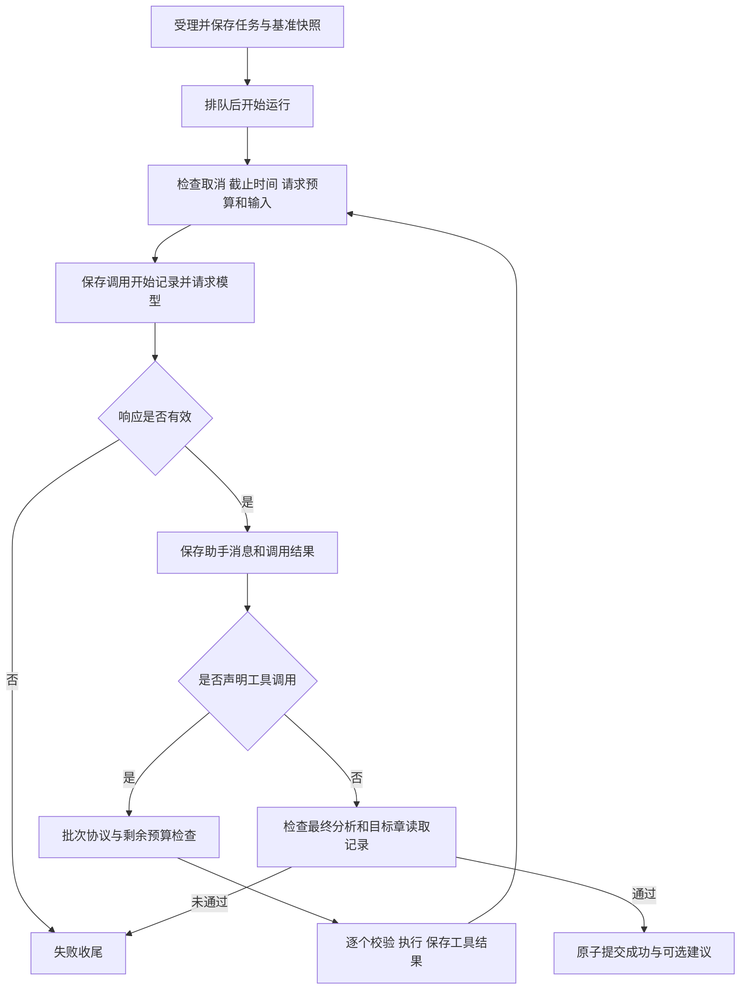
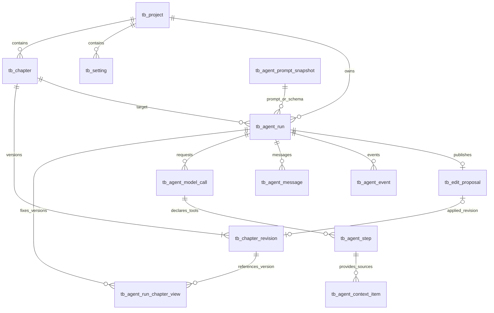

# 墨界 Mojie · 显式 Agent 工具循环 PRD

## 文档信息

**版本：** 0.1  
**日期：** 2026-09-27  
**本次补充：** 第 8.1 节明确涉及的 13 张物理表、新建/复用归属、关联键、读写时机与事务边界，并增加数据库专项验收。  
**状态：** 功能需求稿；尚未实现和验收。  
**适用范围：** 单用户、单实例、单 Agent、单模型提供方；一次任务检查一个已保存章节。  
**对应阶段：** M2 只读分析闭环、M3 修改建议闭环。  
**依据：** [MVP PRD v0.3](MVP_PRD_v0.3.md) 第 4.5、5、6、7、8、9、10 节。  
**配套设计：** [架构决策 v0.3](../adr/MVP_ADR_v0.3.md)、[工程框架设计 v0.1](../design/Framework_Design_v0.1.md)。

本文把总 PRD 中分散的工具循环要求整理成一个可开发、可验收的功能单元。工具、任务生命周期、版本和事件协议沿用总 PRD；新增的边界决策集中列在第 12 节。本文是总 PRD 的细化，不替代整体 MVP 验收，也不改变七工具和现有预算上限。如发现冲突，应同步修订相关文档，不在实现中自行选择不同口径。

## 1. 功能定位与目标

作者提交一次章节检查任务，Agent 按需查阅当前章节、其他章节和设定，形成分析及可选的修改建议。后端显式控制模型请求、工具执行、结果回填、预算和结束条件，保存可核查的过程。

“显式”表示循环控制权在本项目后端：模型只提出工具调用和分析文本，后端决定调用是否合法、是否还有执行资源以及结果是否可以提交。模型适配层和 SDK 不另行自动执行工具或启动循环。

### 1.1 用户价值

- 作者能知道本次分析实际依据哪些章节、设定和版本。
- Agent 可根据任务选择查阅路径，无需作者手工复制所有资料。
- 作者能查看进度、停止任务，并在刷新后查询结果和执行记录。
- AI 先提出建议，作者确认且版本校验通过后才更新正文。
- 任务失败时能解释原因，不把未完成检查显示成成功。

### 1.2 核心场景

作者在第 12 章提交：“检查林舟的行为是否与人物设定、前文经历矛盾；如果有，给出修改建议。”

Agent 可以读取目标章、搜索并读取人物设定、搜索“游泳”及相关前文章节，再给出分析。有修改必要时提交目标章候选稿；没有修改必要时仅返回分析。该路径仅为示例，工具顺序不写死。

### 1.3 能力边界

后端能验证资源范围、实际提供给模型的内容、调用顺序和任务状态，不能仅凭执行成功保证所有文学判断正确。字面搜索无命中不能证明全书不存在相关描写；最终分析应如实说明实际覆盖范围和证据不足之处。

## 2. 功能范围

| P0 包含 | 本期不包含 |
| --- | --- |
| 一次任务围绕一个目标章，支持多轮模型请求 | 多 Agent 协作、通用工作流画布、全书自动写作 |
| 六个只读工具和一个候选稿工具 | 任意 Shell、SQL、文件系统或外部网络工具 |
| 同一响应内多个工具按顺序执行 | 并行工具执行、后台子任务 |
| 工具错误回填，模型可在预算内修正 | SDK 隐藏重试、无限重试 |
| 持久化消息、调用、步骤、来源和事件 | 模型隐藏推理展示、完整网络包留存 |
| 停止、超时、预算限制、刷新恢复展示 | 服务重启续跑、审批后恢复循环 |
| 正常结束后发布建议，独立采纳 | 自动修改正文、跨章改写、部分采纳和自动合并 |
| 完整响应处理、步骤进度推送 | 逐字流式输出、流式工具参数增量执行 |

不同 run 不自动继承历史任务消息。“重新运行”基于当前已保存目标章创建新 run；旧结果和记录仍可查询。

## 3. 作者操作与界面行为

### 3.1 发起任务

1. 作者选择目标章，输入 1–2,000 个 Unicode 码点的检查要求，可使用并修改预填示例。
2. 页面展示目标章和当前正文版本；存在未保存正文时，先完成保存才能提交。
3. 前端提交作品、目标章、expectedVersion、instruction 和 clientRequestId。网络重试同一次提交复用原 clientRequestId。
4. 后端校验范围、版本、模型配置及容量，固定目标章基准版本和正文，创建任务并立即返回 runId。
5. 页面进入排队或运行状态。每作品最多一个活动任务，重复提交遵守总 PRD 的幂等和活动槽规则。

模型未配置时，提交入口说明原因，内容编辑仍可使用。

### 3.2 查看过程

| 区域 | 必须展示 | 行为 |
| --- | --- | --- |
| 任务概况 | 目标章、基准版本、用户指令、排队/运行/终态 | 以后端状态为准 |
| 当前进度 | 请求模型、正在执行的工具动作、正在停止 | 来源于真实调用和事件，不显示虚构百分比 |
| 执行记录 | 工具名称、参数摘要、状态、结果摘要、耗时、错误 | 默认折叠长内容；中间模型文本不标为最终分析 |
| 搜索来源 | 关键词、范围、片段、章节/设定、来源版本及 hasMore | 摘录与完整读取明确区分 |
| 最终结果 | 分析、实际查阅来源、可选建议入口 | 只展示已提交结果；失败记录保留但不冒充完整分析 |

点击章节来源打开对应历史版本的只读内容，并按历史位置定位，不替换当前编辑器草稿。不展示模型隐藏推理、系统提示全文、密钥或服务端堆栈。

### 3.3 停止与恢复展示

- 运行中提供“停止”按钮；请求后显示“正在停止”，后端确认 CANCELLED 后才显示“已停止”。
- 排队任务可以直接取消；已成功的任务收到取消请求时仍返回成功状态。
- 关闭页面、切换章节或 SSE 断线不取消任务。重新进入页面通过查询活动/历史任务恢复展示。
- SSE 断线显示重连状态，持续失败时按总 PRD 降级查询；已知终态后关闭订阅和轮询。
- 失败或取消后可“重新运行”；当前章若有未保存改动，仍需先保存。

### 3.4 完成与采纳

分析完成且无需修改时，展示分析，不出现采纳按钮。存在建议时，展示任务基准原文、建议稿、理由和基准版本，支持整体接受/拒绝。

采纳沿用总 PRD 的独立业务接口：目标章有未保存编辑时禁用接受；后端校验建议状态和正文版本；冲突时保留现有正文和建议，不强制覆盖。拒绝建议不改变已经成功的任务状态。

## 4. 运行上下文与工具契约

### 4.1 每次运行固定的信息

后端固定用户范围、projectId、runId、targetChapterId、baseVersion、baseContent、系统约束、工具 schema 和模型配置。模型只能提供工具公开的业务参数，不能修改所属用户、作品或目标章。

初始模型输入包括系统约束、当前任务描述和定位目标所需的元数据。baseContent 保存在后端，不以“已经固定快照”代替工具读取：成功仍要求 read_chapter 返回完整目标章。

任务独立持有消息工作副本、读取缓存、预算和候选稿。工具定义可以共享；共享工具实例不能存放某次运行的 runId、messages、读取结果或数据库会话。

小说正文、设定和工具返回内容作为待分析数据，不得据其文字扩大权限、变更工具定义或跳过后端约束。

### 4.2 七个原子工具

| 工具 | 模型参数 | 返回与约束 |
| --- | --- | --- |
| list_chapters | cursor、limit，可选 | 当前作品章节元数据及分页，不含正文；默认 20 条、最多 50 条 |
| read_chapter | chapterId | 完整正文与版本；目标章使用基准快照，其他章遵守首读/搜索视图规则 |
| search_chapters | keyword；scope、limit、cursor 可选 | 字面定位与摘录；默认 BEFORE_TARGET、10 个命中，最多 20 个；可显式选择 ALL_CHAPTERS |
| list_settings | type、cursor、limit，可选 | 当前作品设定元数据；默认 20 条、最多 50 条 |
| read_settings | settingIds | 1–5 个完整设定条目；重复 ID 为参数错误，任一 ID 不合法则整批拒绝 |
| search_settings | keyword；type、limit、cursor 可选 | 设定标题/正文的字面定位和摘录；默认 5 条、最多 20 条 |
| propose_edit | proposedContent、reason | 校验并保存本次目标章候选稿；不直接产生可采纳建议，不修改正式正文 |

list 用于枚举，search 用于定位，read 用于读取完整证据。设定和正文搜索均不依赖嵌入模型；字面语义、游标校验、摘录和位置字段完整沿用总 PRD 5.4、5.9，本功能不新增另一套检索协议。

工具业务结果统一为 `{success, data, error}`；循环在实际回填中附加 `budget`。错误至少包含 code、可读 message 和 retryableByModel。后者表示模型能否通过修正参数再次调用，不代表执行层自动重试；false 也不必然结束 run，例如一次搜索超时后可以改用目录和读取工具。

### 4.3 版本与来源

- 目标章始终读取任务创建时的基准版本，即使作者在运行中保存了新正文。
- 其他章节首次完整读取后固定首读版本；同一 run 重复读取返回相同内容。
- 首次正文搜索建立并保存版本视图：目标章用基准版本，已读章用首读版本，其余章用此次捕获的版本。后续搜索和读取使用该视图；不宣称整部作品在同一时刻的全局快照。
- 活动任务期间设定不可增删改，沿用总 PRD 的内容变更约束。
- contextManifest 区分 FULL_CHAPTER、FULL_SETTING 和 SEARCH_SNIPPET，关联资源、版本或内容哈希、位置和工具执行。目录元数据、扫描过的正文、版本指针均不能算已读全文。
- 展示“已提供给模型”的来源须能关联实际模型请求的输入消息。仅执行并保存、但因取消或预算不足未进入后续请求的结果，保留在步骤中，不宣称模型已收到。

### 4.4 候选稿条件

propose_edit 只作用于后端固定的目标章。必须先完整读取目标章；正文非空、最多 6,000 码点，且与基准正文不同；reason 必填且最多 2,000 码点。一次 run 最多保留一份有效候选稿。

无效候选返回工具错误，模型可在剩余预算内修正；已有有效候选后不能再次提交第二份。工具成功表示候选校验通过；只有 run 成功事务才发布 PENDING 建议。之后失败、取消、超时或超预算，不得发布该候选。

## 5. 显式循环行为

### 5.1 执行流程

任一检查发现取消、超时或资源不足，都进入相应收尾；任一持久化失败停止后续执行。图中工具循环仅在整个批次完成并持久化后进入下一次模型请求。

### 5.2 模型响应处理

1. 每次请求只允许一次提供方尝试；先保存开始记录和有序输入消息引用，再在数据库事务外请求模型。
2. 适配器返回完整响应及完成原因。使用流式 SDK 时，先完整聚合，不能收到半段参数就执行。
3. 先校验响应结构、完成原因及整批调用 ID。缺失/重复 ID、无法对应的结构、截断或完成原因与内容矛盾，均不得执行任何工具。
4. 合法响应同时包含文本和工具调用时，保存两者，按工具分支继续；该文本不作为最终结果。
5. 没有工具调用且完成原因表明正常结束时，才进入最终分析校验。空白文本、拒绝、未知且无法解释的完成原因分别记录，不包装成成功。

响应整体不可解析属于模型协议错误；若某个调用的 ID 和名称可正常识别，但参数不是合法对象或不符合 schema，则作为该工具的参数错误回填，不猜测修复参数。

### 5.3 工具批次处理

整批通过协议校验后，按模型声明顺序串行处理。一个响应可以先调用 read_chapter 再调用 propose_edit，后者必须基于前者实际成功后的状态判断。

每个调用的处理顺序为：检查停止条件 → 占用工具调用次数并建立步骤 → 查找工具、校验参数和范围 → 执行业务动作 → 保存实际结果及步骤/事件 → 追加消息。

未知工具、参数或范围错误计入工具次数，返回相应错误消息，后续调用仍可按序处理。遇到取消、run 超时、累计预算超限或持久化故障时，立即停止该批次；未完成项记录 ABORTED，不能伪造成功结果补齐。

工具结果按 `modelCallId + toolCallId` 与声明配对，每次本地执行另有 toolExecutionId。不同 run 或不同模型轮次可以复用提供方调用 ID，不能因此串用数据。只有整批工具结果完整对应且保存成功后，才允许请求下一轮模型。

### 5.4 最终成功条件

必须同时满足：

- 模型正常结束，无待处理工具调用，最终分析非空。
- 完整目标章已通过 read_chapter 成功读取，并已作为工具结果提供给生成结论的模型请求。
- 未发生取消、超时或超限，所有用于结论的消息和工具结果已保存。
- 成功提交事务确认任务仍可完成，保存分析、可选 PENDING 建议、SUCCEEDED 状态和对应事件。

未读完整目标章就结束返回 INSUFFICIENT_CONTEXT；搜索命中目标章不满足要求。候选稿不是成功的必要条件。任务执行成功表示流程完成，不代表已经验证全书或已经采纳修改。

## 6. 预算与截止时间

### 6.1 初始配置

以下沿用总 PRD 9.2，属于待实测的初始限制。

| 资源 | 限制 |
| --- | --- |
| 模型请求 | 每 run 最多 8 次；纠错请求同样计入 |
| 工具调用 | 每 run 最多 12 次；失败、重复读取和分页调用同样计入 |
| 工具结果累计文本 | 最多 30,000 个 Unicode 码点 |
| 模型连接/单次请求 | 最多 10 秒/60 秒，受运行剩余时间约束 |
| 运行/排队 | 开始运行后最多 180 秒；排队最多 60 秒 |
| 正文搜索 | 单次最多 5 秒且不超过 run 剩余时间；单页 data 最多 12,000 码点 |
| 执行容量 | 全局 2 个运行、8 个排队；每作品最多 1 个活动任务 |

截止时间由独立周期检查落实，初始每 2 秒检查一次，不能只等模型返回。运行成功提交时也必须重新校验截止时间。

系统提示同步告知模型请求和工具调用的次数上限，要求为无工具调用的最终分析预留一次请求；有候选稿时，提交候选后仍需该收尾请求。参数已知且互不依赖的工具调用可在同一响应中声明，后端仍按顺序执行；提示不规定固定工具路径，也不改变预算检查和终止规则。

每次工具回填的 `budget` 记录该工具执行后的 `modelCallsUsed`、`modelCallsRemaining`、`toolCallsUsed`、`toolCallsRemaining` 和 `finalResponseRequired`。剩余模型次数包含下一次响应及最终分析；只剩一次模型请求或工具次数已用尽时，`finalResponseRequired=true`。多工具批次以最后一条回填为最新预算。成功和错误结果均附加预算，同一份完整 JSON 保存为步骤结果和工具消息并计入累计工具文本；这是提示信息，后端仍独立强制预算规则。

### 6.2 次数边界细化

**模型次数。** 开始一次已记录的模型请求即占用一次，不因错误退还。第 8 次返回合法最终分析可以成功；若仍要求调用工具，则没有下一次请求预算，该批工具不执行，run 以预算耗尽失败。不额外赠送收尾请求。

**工具次数。** 每个进入分发校验的调用占用一次，包括未知工具和非法参数。未执行即整批拒绝的调用不计为已执行；声明仍留在助手消息和 ABORTED 步骤中。开始批次前比较批次大小与剩余次数，不足则整批不执行。

**达到上限不等于超限。** 正好完成第 12 次工具调用且模型请求还有余额时，可再请求模型生成最终分析；若该响应继续要求工具，则因剩余工具次数不足失败。run 内工具 schema 保持固定，后端预算检查负责拒绝超限动作。

### 6.3 文本与模型上下文

累计工具文本按准备回填的统一工具结果 JSON 字符串计数，包括成功/错误包装、data 和 error；采用固定的紧凑序列化方式，非 ASCII 字符不额外转义，按 Unicode 码点而非字节或 UTF-16 单元计数。

每条新增结果只累计一次。重复读取产生的新结果和错误结果均累计；历史结果在下一轮再次发送不重复增加累计值。模型调用 ID、传输包装等适配器协议开销另由完整模型上下文检查覆盖。

返回完整读取结果前校验单次可容纳性；放不下时返回 RESULT_TOO_LARGE，不截取半份正文冒充全文。将一条结果加入消息会使累计量超过 30,000 时，直接结束 run，不通过删除旧消息、静默截断或替换为短错误继续执行。失败前已生成但未送入模型的结果可以留作诊断，不能标记为模型已读。

每轮还须独立检查完整输入和输出预留，包含系统提示、schema、用户指令、助手消息、工具结果及必要协议字段。字符限制不能替代模型上下文限制。工具累计量正好为 30,000 时，只要完整模型上下文仍可容纳，允许请求最终分析。

SDK 自动网络重试关闭；本期不做循环层自动重试。接近 6,000 码点的正文及完整候选稿必须通过真实模型验证，不能靠截断正文满足输出预算。

## 7. 错误、取消与终态

### 7.1 分类规则

| 情况 | 工具/任务处理 | 作者可见结果 |
| --- | --- | --- |
| 参数错误、未知工具、越权资源 | 结构化工具错误；可在预算内修正参数，不泄漏资源标题/正文 | 对应步骤失败，任务可继续 |
| 搜索无命中 | success=true，空集合 | 本次搜索无命中，不说“没有矛盾” |
| 搜索超时或规模超限 | SEARCH_TIMEOUT / SEARCH_SCOPE_TOO_LARGE；不返回部分结果，可改用其他工具 | 搜索失败及具体原因 |
| 单次结果过大 | RESULT_TOO_LARGE；可调整分页或读取选择，不能截断全文 | 工具失败及原因 |
| 模型鉴权、限流、网络、请求超时 | FAILED；分别记录原因，不自动重试 | 失败原因与重新运行入口 |
| 模型服务要求付费或余额不足（HTTP 402） | FAILED / MODEL_PAYMENT_REQUIRED；不自动重试，不发布候选稿 | 检查模型账户余额或付费权限 |
| 无效模型响应、截断、拒绝、空最终分析 | FAILED；不发布候选稿 | 对应原因，不显示成功修改 |
| 未读完整目标章 | FAILED / INSUFFICIENT_CONTEXT | 缺少目标章上下文 |
| 模型/工具/累计文本/上下文预算不足 | FAILED；记录触发的预算类型、已用量和上限 | 已达到本次任务限制 |
| 排队或运行超时 | FAILED / RUN_TIMEOUT | 任务超时 |
| 用户取消生效 | CANCELLED | 已停止，无新建议 |
| 服务重启 | 遗留任务 FAILED / SERVICE_RESTARTED | 服务中断，可重新运行 |
| 持久化故障 | 停止执行；可提交时记 PERSISTENCE_ERROR，否则恢复后补记 | 不提前显示成功 |

已有错误码沿用总 PRD；其他分类的具体 code 在共享错误契约中固定，不能只靠前端颜色或自由文本区分。retryableByModel=false 不允许执行层原样自动重试；真正的 run 级终止错误不再请求模型解释或补救。

### 7.2 状态与并发收尾

任务状态保持 QUEUED、RUNNING、SUCCEEDED、FAILED、CANCELLED。“正在停止”由 RUNNING + cancelRequested 表示，不增加任务终态。

成功与取消以数据库条件更新仲裁：成功已提交则保持成功；取消标记先提交则后续不能发布成功结果或建议。晚到的模型响应不再推进业务。取消不承诺强制终止远端模型计算或计费；本地执行容量直到实际资源退出才释放。

终态不可回退，未完成调用/步骤必须收尾为失败或 ABORTED。数据库整体不可用时，停止执行、报告健康异常；恢复后先回读确认提交结果，不能把已经提交的成功改成失败。服务重启清理和执行身份保护沿用总 PRD 6.5–6.8。

## 8. 持久化、接口与工程边界

### 8.1 数据库表与读写关系

#### 8.1.1 新建与复用口径

**表名规范：** 本项目数据库物理表统一使用 `tb_` 前缀及小写下划线命名，例如 `tb_project`、`tb_agent_run`。表清单、关联关系、SQL 和迁移建表须使用同一名称；字段名、业务类名、API、事件名及工具名不加此前缀。

本功能共涉及 **13 张物理表：复用内容模块 4 张表，新建 Agent 运行与记录表 8 张，新建建议模块表 1 张**。与工程框架设计 6.2 的 13 张表一致，不额外复制一套 Agent 专用章节、设定或历史表。

这里的“复用”指模块归属：`tb_project`、`tb_chapter`、`tb_chapter_revision`、`tb_setting` 由 M1 内容模块建设，本功能通过业务服务使用；“新建”指由 Agent 或建议模块建设，并非断言数据库中已经有前四张表。目前仓库处于设计阶段，实际建表和迁移仍待实现。

`tb_edit_proposal` 由 M3 建议模块负责，本功能在成功收尾时调用该模块发布建议，任务查询再读取建议状态。总 PRD 的 contextManifest、chapterViewManifest 和提示词/schema 快照分别落到独立物理表，所以 10 个逻辑实体对应 13 张物理表。

#### 8.1.2 复用的业务表

| 表 | 归属/处理方式 | 本功能读取什么 | 本功能是否写入 | 必须保留的关联与约束 |
| --- | --- | --- | --- | --- |
| `tb_project` | M1 内容模块；复用并使用活动槽字段 | `id`、`owner_id`、删除标记、`active_run_id` | 创建任务时占用活动槽；任务收尾时按本次 run 身份清空。若内容表先落地但尚无 `active_run_id`，接入 Agent 时补充该字段 | `tb_agent_run.project_id` 指向作品；`active_run_id` 只表示当前活动任务，历史任务通过 `tb_agent_run.project_id` 查询；槽内任务必须属于同一作品 |
| `tb_chapter` | M1 内容模块；复用 | `id`、`project_id`、`chapter_order`、标题、当前 `version/content`、删除标记，用于范围校验、目录和创建基准快照 | 循环及 propose_edit 不更新；只有作者独立采纳建议时，由内容服务校验版本并更新正文和版本 | `UNIQUE(project_id, chapter_order)`；目标章必须属于本次作品；当前正文与对应历史版本一致 |
| `tb_chapter_revision` | M1 内容模块；复用历史能力与建议来源字段 | 按 `chapter_id + version` 读取固定版本的完整正文，支撑读取、搜索和来源查看 | 循环不新增历史；采纳成功时新增一条 `source=AGENT` 的历史，关联 `proposal_id` | `UNIQUE(chapter_id, version)`；非空 `proposal_id` 唯一，防止一份建议生成多条历史；P0 不物理删除历史 |
| `tb_setting` | M1 内容模块；复用 | 当前作品的设定 `id`、`type`、标题与正文，供 list/read/search | Agent 不写；活动任务期间内容模块禁止增删改设定 | 按 `project_id` 限定范围；本期无独立设定版本表，实际返回内容保存在工具消息，来源用内容哈希关联 |

`active_run_id`、`tb_chapter_revision.proposal_id` 已在工程框架中规划；此处将其列为功能依赖，不要求对同一字段重复执行新增迁移。章节标题/顺序、删除等内容变更仍受总 PRD 6.6 的活动任务约束。

#### 8.1.3 本功能新建或由协作模块建设的表

下表列出最少业务字段；普通主键、创建/更新时间等基础字段由详细 DDL 补齐。状态、消息和结果都须落库，不能仅保存在内存对象里。

| 表 | 新建归属/使用阶段 | 存储内容与主要字段 | 写入/读取时机 | 关键约束 |
| --- | --- | --- | --- | --- |
| `tb_agent_run` | Agent 任务模块，M2 | `id`、`owner_id`、`project_id`、`target_chapter_id`、`instruction`、`client_request_id/request_digest`、`base_version/base_content`、`status/cancel_requested`、排队/运行时间与截止时间、`process_instance_id`、结果/错误、`last_event_seq`、`prompt_hash/tool_schema_hash/config_snapshot`；模型/工具次数和累计文本量 | 受理时插入；调度、取消、计数和终态时更新；任务列表/详情及恢复查询读取 | `UNIQUE(owner_id, client_request_id)`；同键不同请求摘要拒绝；终态不可回退；目标章和作品范围一致 |
| `tb_agent_prompt_snapshot` | Agent 上下文模块，M2 | `hash`、`kind`、完整 `content`，保存系统约束或工具 schema 的不可变快照 | 注册配置或创建任务时按哈希复用/新增；模型输入还原和开发排查读取 | `hash` 主键；哈希计算覆盖 kind 与规范化内容，避免类型混淆；相同哈希不得覆写成不同内容；run 的两个哈希必须能解析到相应类型的完整快照 |
| `tb_agent_run_chapter_view` | Agent 检索上下文模块，M2 | `run_id`、`chapter_id`、`chapter_order`、`version`、`view_id`，保存 chapterViewManifest | 首次正文搜索时批量写入；后续搜索、分页和 read_chapter 查询复用，不随正文修改更新 | `PRIMARY KEY(run_id, chapter_id)`；同一 run 使用同一 view_id；`chapter_id + version` 对应 `tb_chapter_revision`；仅存版本指针，不复制全书正文 |
| `tb_agent_context_item` | Agent 来源记录模块，M2 | `run_id`、`kind`、来源章节/设定 ID、章节版本、行号/码点位置、`content_hash`、`tool_execution_id`，保存 contextManifest | 成功读取/返回搜索片段并保存结果时写入；任务来源展示、历史定位和追踪读取 | kind 为 FULL_CHAPTER/FULL_SETTING/SEARCH_SNIPPET；关联本 run 的工具步骤；全文和摘录区分；是否送入模型由消息输入关联判断，不以本表有记录为准 |
| `tb_agent_model_call` | Agent 调用记录模块，M2 | `id`、`run_id`、`call_index`、有序 `input_message_seqs`、配置引用、状态、开始/结束、`finish_reason`、错误、`provider_request_id`、可空 `usage` | 请求前写开始记录；响应/失败后更新；重启或异常时收尾；追踪和用量展示读取 | `UNIQUE(run_id, call_index)`；输入消息均属于本 run；用量缺失留空，不估造成真实计费数据 |
| `tb_agent_message` | Agent 消息记录模块，M2 | `id`、`run_id`、`message_seq`、`role`、`content`、`model_call_id`、`tool_call_id`、状态及必要协议字段 | 创建任务时存初始输入；响应时存助手消息；工具完成时存实际回填结果；后续模型请求按序读取 | `UNIQUE(run_id, message_seq)`；助手工具声明与工具结果可按模型轮次/调用 ID 对应；初始消息的模型调用引用可为空 |
| `tb_agent_step` | Agent 工具步骤模块，M2 | `tool_execution_id`、`run_id`、`model_call_id`、`tool_call_id`、工具名称、`args/result`、`summary`、状态、错误及时间 | 工具开始时记录；结束时更新结果；合法但未执行的调用可记录 ABORTED；界面步骤和排查读取 | `tool_execution_id` 主键；`UNIQUE(model_call_id, tool_call_id)`；本地执行 ID 与提供方调用 ID 分开，跨 run 不混用 |
| `tb_agent_event` | Agent 事件模块，M2 | `run_id`、`seq`、`type`、`payload`、`occurred_at`，保存产品进度事件 | 与对应业务状态在同一事务写入；SSE 按 seq 跟读并支持补发 | `PRIMARY KEY(run_id, seq)`；与 `tb_agent_run.last_event_seq` 一致；记录已提交事实，不存大段完整正文或密钥 |
| `tb_edit_proposal` | 建议模块，M3；本功能调用发布与查询能力 | `id`、`run_id`、目标章、`base_version/base_content`、`proposed_content`、`reason`、`status`、`applied_version` | run 成功且存在有效候选时插入 PENDING；后续独立接受/拒绝/冲突处理更新；结果页和建议页读取 | `UNIQUE(run_id)`；一次 run 最多一条已发布建议；仅成功任务可发布；采纳后与一条 `tb_chapter_revision.proposal_id` 对应 |

任务计数可在 `tb_agent_run` 保存汇总，底层调用/步骤记录必须足以核对。步骤中的失败次数与模型声明但未执行的 ABORTED 次数需要区分，不能简单把步骤行数当成已消耗工具次数。

#### 8.1.4 表间关联与数据来源

图表示业务关联，不代替完整外键 DDL。关键关联口径如下：

- **任务与作品/章节：** `tb_agent_run.project_id → tb_project.id`，`target_chapter_id → tb_chapter.id`；`base_version` 对应目标章历史版本。单独存在两个外键不足以证明章节属于作品，受理及工具业务服务仍要校验同一作品范围。
- **活动槽与历史任务：** `tb_project.active_run_id → tb_agent_run.id` 是可空的当前指针；任务表中的 project_id 才是历史归属。清理槽时必须附带 `active_run_id = 本次 runId` 条件。
- **搜索视图与正文：** `tb_agent_run_chapter_view.(chapter_id, version) → tb_chapter_revision.(chapter_id, version)`；先按 run 固定指针，再读取历史正文，不直接搜索最新版后声称遵守视图。
- **消息与工具配对：** 助手消息、工具消息和 `tb_agent_step` 通过 `model_call_id + tool_call_id` 定位同一调用；`tb_agent_model_call.input_message_seqs` 引用本 run 有序消息。工具结果消息的 model_call_id 表示声明该工具的轮次，不是消费该结果的下一轮。
- **来源是否送入模型：** `tb_agent_context_item.tool_execution_id → tb_agent_step`，再经上述配对找到工具结果消息；只有该消息出现在已实际发起的模型请求输入中，才能标为已提供给模型。仅有调用开始记录但尚未发出请求，或记录不足以确认发送时，不推断模型已收到。
- **候选、建议与正式历史：** 候选正文已存在于 propose_edit 的助手调用参数/步骤中，内存保留本次有效候选；本期不新增 candidate 表，也不提前创建 tb_edit_proposal。成功时发布建议，采纳时才写 tb_chapter 和 tb_chapter_revision。

同一 run 范围、顺序和调用配对是强制业务约束；普通外键可直接表达的关系由数据库约束，数组输入引用和多态来源等关系还需业务校验与集成测试。若模型返回缺失/重复调用 ID，保留模型调用失败和可保存的响应信息，不强造 ID 插入违反唯一约束的步骤。

**相似字段的数据职责。** `tb_chapter.content` 是当前正式正文，`tb_chapter_revision.content` 是不可变历史，`tb_agent_run.base_content` 是本次目标基准，`tb_edit_proposal.base_content/proposed_content` 是作者比对和采纳的固定内容。工具回填的实际协议内容以 `tb_agent_message` 为准，`tb_agent_step.result/summary` 服务执行记录，`tb_agent_context_item` 只做来源索引，`tb_agent_event.payload` 只做进度展示。同一工具的消息与步骤结果必须由同一结果对象在一个事务中保存，不能独立生成两个版本。

原始工具结果保存在受控业务表，普通日志只输出标识、摘要和错误。来源没有独立历史表的设定，也必须能从保存的工具消息还原实际内容；只有 ID 或内容哈希不算保留正文。快照表不得保存密钥或鉴权请求头。

#### 8.1.5 七个工具分别涉及哪些表

所有工具执行均产生 `tb_agent_step` 和对应 `tb_agent_event`；可回填的结果还写入 `tb_agent_message`，并按规则更新 `tb_agent_run` 的预算。下面只列各工具额外的业务读写，避免将过程记录误认为正文修改。

| 工具 | 业务读取 | 额外写入 | 明确不写入 |
| --- | --- | --- | --- |
| list_chapters | `tb_project` 范围、`tb_chapter` 元数据 | 无来源全文记录 | 不改 tb_chapter，不写 tb_chapter_revision |
| read_chapter | `tb_project/tb_chapter` 范围；目标读 `tb_agent_run.base_content`；其他章按缓存或 `tb_agent_run_chapter_view` 读取 `tb_chapter_revision` | 成功结果对应的 `tb_agent_context_item` | 不更新正文或历史 |
| search_chapters | `tb_project/tb_chapter` 范围与版本元数据、`tb_agent_run` 基准、首读记录、`tb_agent_run_chapter_view`、`tb_chapter_revision` | 首次搜索写 `tb_agent_run_chapter_view`；实际返回片段写 `tb_agent_context_item` | 不复制全书正文到消息，不更新章节 |
| list_settings | `tb_project` 范围、`tb_setting` 元数据 | 无来源全文记录 | 不修改设定 |
| read_settings | `tb_project` 范围、`tb_setting` 完整条目 | 成功结果对应的 `tb_agent_context_item` | 不修改设定、不创建设定历史表 |
| search_settings | `tb_project` 范围、`tb_setting` 标题/正文 | 实际返回片段对应的 `tb_agent_context_item` | 不修改设定 |
| propose_edit | `tb_agent_run` 基准、本 run 的完整目标章读取记录及有效候选状态 | 候选参数和校验结果保留在通用消息/步骤记录 | 不在此时写 tb_edit_proposal、tb_chapter 或 tb_chapter_revision |

工具业务读取允许使用本 run 已验证的缓存，但不能绕过范围校验规则。搜索扫描过而未返回的内容、目录项、失败读取不能写成已读全文来源。

#### 8.1.6 按执行阶段划分的读写与事务

| 阶段 | 读取表 | 同一短事务内的写入 | 事务外动作/限制 |
| --- | --- | --- | --- |
| 创建 run | tb_project、tb_chapter、tb_chapter_revision、tb_agent_run 幂等记录、tb_agent_prompt_snapshot | 插入 tb_agent_run 和初始 tb_agent_message、run.queued 事件；占用 tb_project.active_run_id。引用的提示词/schema 快照须已存在或一并插入 | 先完成受理事务再调度；同键重试返回原任务，事务失败不能只留下活动槽 |
| 开始运行 | tb_agent_run | 状态及运行截止时间、run.started 事件 | 不在事务中等待模型 |
| 发起模型请求 | tb_agent_run、tb_agent_message、tb_agent_prompt_snapshot | tb_agent_model_call 开始记录、有序输入引用、模型次数及 model.started 事件 | 提交后调用模型；必要协议输入和配置在本 run 固定 |
| 保存模型响应 | tb_agent_run、tb_agent_model_call | 模型调用结果、合法助手 tb_agent_message、model.finished 事件；无效响应保存失败诊断 | 事务成功后才进入工具处理；取消等终态已生效则不推进 |
| 工具开始/完成 | tb_agent_run、tb_agent_step 及工具业务表 | 开始事务保存步骤、工具次数和 tool.started；完成事务保存实际结果、工具消息、来源、累计文本及 tool.finished | 开始和完成是两个短事务；正文扫描在事务外。累积超限结果仅作诊断，不作为已回填消息继续调用 |
| 首次正文搜索固定视图 | tb_chapter、tb_agent_run、首读记录 | 先短一致性读取版本清单，结束读取事务，再在短写事务保存 tb_agent_run_chapter_view | 清单保存成功才扫描对应 tb_chapter_revision；不在只读事务写入 |
| 成功收尾 | tb_agent_run、有效候选及已保存的工具记录 | 最终分析、SUCCEEDED、可选 tb_edit_proposal、run.succeeded 事件，按本次身份清空 tb_project 活动槽 | 任一写入失败均不可对外宣布成功；物理执行容量仍待实际退出释放 |
| 取消/失败/超时收尾 | tb_agent_run、未完成 tb_agent_model_call/tb_agent_step | 取消请求先写标记；确认终态时写状态及事件、收尾未完成记录、按本次身份清空活动槽 | 不新增可采纳建议；数据库不可用时遵守恢复补记规则，不伪造已提交终态 |
| 查看详情/SSE | tb_agent_run、tb_agent_step、tb_agent_context_item、tb_agent_event；有建议时读 tb_edit_proposal | 无 | 详情使用一致快照；SSE 只读取已提交事件；完整消息仅由受控 trace 查询 |
| 作者采纳建议 | tb_project、tb_edit_proposal、tb_chapter | 按版本更新 tb_chapter，插入 source=AGENT 的 tb_chapter_revision，更新 tb_edit_proposal 为 APPLIED 并记录 applied_version | 独立于已结束的 run；不重启循环，不改任务成功终态，不向已经结束的 run 追加采纳事件 |

拒绝只更新建议状态，版本冲突按总 PRD 标记 CONFLICTED，均不修改正文和章节历史。上述写事务遵守统一锁顺序：tb_project → tb_agent_run / tb_edit_proposal → tb_chapter；循环不能直接越过内容/建议业务服务写正式内容。

#### 8.1.7 迁移、索引与保留规则

迁移分组沿用工程框架设计：`V1__content` 建设 4 张内容表；`V2__agent_run` 建设 tb_agent_run、tb_agent_prompt_snapshot、tb_agent_run_chapter_view、tb_agent_context_item；`V3__trace` 建设 tb_agent_model_call、tb_agent_message、tb_agent_step；`V4__proposal_event` 建设 tb_edit_proposal、tb_agent_event。这表示完整 schema 的迁移顺序，不意味着 tb_agent_event 可以等到 M3 才建：M2 开放任务受理前必须安装所需完整迁移；tb_edit_proposal 可以提前建表，但 M3 前不发布建议。

跨后续迁移的外键须在被引用表存在后追加，例如 tb_project.active_run_id、tb_chapter_revision.proposal_id、tb_agent_context_item.tool_execution_id，不能让 V1/V2 直接引用尚未创建的表。具体 SQL、类型和物理外键名由工程设计确定。

除上述唯一键，至少为以下查询提供索引：按作品/创建时间/ID分页查 run、按状态和截止时间扫描活动 run、按 run/轮次或顺序查询调用及步骤、按 run/工具执行查询来源、按建议状态与目标章检查待处理建议。事件的 `(run_id, seq)` 主键直接支撑跟读；章节历史的 `(chapter_id, version)` 唯一键支撑版本读取。查询字段和排序应与实际索引一致，不无依据地为所有 JSON 字段建索引。

P0 不增加消息、事件、快照和来源的自动清理策略；作品/章节逻辑删除不能级联物理删除任务依据。原始消息、快照和设定历史内容仅按业务/开发权限读取，普通任务详情不直接暴露完整系统提示或无关模型协议字段。

### 8.2 接口与事件复用

复用总 PRD 7.3 的 `/api/v1/agent/runs` 创建/列表、`/{id}` 详情、`/{id}/cancel` 取消、`/{id}/events` SSE 和本地开发模式 `/{id}/trace` 接口，以及独立建议查询/接受/拒绝接口。本功能不新增前端直接执行工具的入口。

事件复用 run.queued、run.started、model.started、model.finished、tool.started、tool.finished、run.succeeded、run.failed、run.cancelled。工具失败通过 tool.finished 的状态和错误表达，不等同于 run.failed。

首次加载先查询一致的任务快照，再从 lastEventSeq 之后订阅；重连遵守 Last-Event-ID 优先规则。前端按 runId + seq 去重，不允许旧快照覆盖新事件。事件传输允许重复，断线恢复不等于模型执行恢复。

### 8.3 模块责任

| 模块 | 责任 |
| --- | --- |
| AgentRunService / AgentRunner | 受理、幂等、调度、生命周期、终态仲裁和清理 |
| AgentLoop | 明确推进请求、批次、回填和结束判断，返回执行结论 |
| ModelGateway | 一次提供方请求及协议转换，不执行工具、不重试 |
| ToolRegistry / AgentTool | 工具定义、分发、参数/范围校验，通过业务服务访问内容 |
| Context / Trace / Event | 消息与预算、版本来源、持久化和进度输出 |
| EditProposalService | 候选校验、成功时发布及独立采纳事务 |

AgentLoop 保持可独立测试，不依赖 HTTP、浏览器连接或数据库驱动。它返回 Completed、Failed 或 Cancelled 等结论，由 Runner/RunService 提交终态。模型请求和正文扫描在数据库事务外执行；工具和事件持久化使用短事务。详细类签名、DDL 和线程实现由工程设计承接。

## 9. 验收标准

以下为待执行用例，编号 AL-AC 独立于总 PRD 的 AC。确定性规则用脚本化模拟模型验证，数据库事务和并发使用 PostgreSQL 集成验证，界面恢复使用端到端验证；真实模型另做质量与预算验证。

| 编号 | 场景 | 必须满足的结果 | 对应总 PRD |
| --- | --- | --- | --- |
| AL-AC-01 | 两个模拟任务走不同工具路径后完成 | 循环均正常推进，路径不写死，目标章完整读取 | AC-04、05 |
| AL-AC-02 | 分析完成，无候选稿 | SUCCEEDED，无建议、无采纳按钮 | AC-05 |
| AL-AC-03 | 读取、提交候选、最终分析 | 任务成功时才发布一条 PENDING；正式正文不变 | AC-04 |
| AL-AC-04 | 未读目标章或仅搜索到目标片段便结束 | INSUFFICIENT_CONTEXT，无建议 | AC-26、39 |
| AL-AC-05 | 合法响应同时有文本和多个工具 | 文本不提前作为最终结果；按序执行并完整配对后继续 | AC-23 |
| AL-AC-06 | 缺失/重复调用 ID、响应截断或完成原因矛盾 | 整批不执行，任务失败，无建议 | AC-13、23 |
| AL-AC-07 | 工具参数错误/未知工具，下一轮修正 | 错误原样记录并回填；失败调用计数，修正后可完成 | AC-12、23 |
| AL-AC-08 | 跨作品读取；设定批内混入非法 ID | 拒绝且不泄漏内容，设定整批拒绝 | AC-12 |
| AL-AC-09 | 两作品并发且模型使用相同调用 ID | 上下文、结果和候选隔离 | AC-23 |
| AL-AC-10 | 修改目标/其他章节后重复读取、搜索和翻页 | 基准/首读/视图规则一致，搜索与读取证据同版 | AC-25、36、37 |
| AL-AC-11 | 第 8 次模型返回合法最终分析；另一场景返回工具 | 前者可成功；后者不执行工具且预算失败，不发第 9 次请求 | AC-13 的边界细化 |
| AL-AC-12 | 第 12 次工具结束且请求仍有余额 | 允许请求最终分析；若再次请求工具则拒绝 | AC-13 的边界细化 |
| AL-AC-13 | 剩余 1 次工具额度，模型声明 2 个工具 | 两个均不执行，保留声明和 ABORTED 记录 | AC-13 的边界细化 |
| AL-AC-14 | 中文/表情、错误结果、重复读取、历史重发 | 按固定序列化码点计数；新增结果累计，历史重发不重复累计 | AC-26、38 |
| AL-AC-15 | 累计恰好 30,000；再加一条会超限；完整模型输入另超限 | 等于上限可收尾；超过时明确失败；不截断或删除消息 | AC-26、38 |
| AL-AC-16 | 候选通过后再失败、取消或截断 | 无可采纳建议；候选只保留诊断记录 | AC-33 |
| AL-AC-17 | 鉴权/网络失败、模型拒绝、空分析、单次请求超时 | 分类准确；一次模型阶段只有一次尝试 | AC-13、24、26 |
| AL-AC-18 | 搜索为空、搜索超时、单次结果过大 | 三者可区分；错误不伪装为空结果，全文不静默截断 | AC-12、38 |
| AL-AC-19 | 排队取消、运行取消、成功与取消竞争、晚到响应 | 唯一终态；取消后不发布；晚到结果不推进业务 | AC-14、22、32 |
| AL-AC-20 | 模型长时间阻塞、排队超时、运行超时 | 独立超时检查生效，记录正确，不永久运行 | AC-13、32 |
| AL-AC-21 | 消息落库失败、终态提交结果未知、数据库恢复 | 停止调用；回读已提交终态，不把成功改为失败 | AC-27 |
| AL-AC-22 | 刷新、断线、重复事件、旧快照迟到、进程重启 | 展示可恢复且不回退；断线不取消，重启旧任务不续跑 | AC-15、16、28 |
| AL-AC-23 | 工具完成但结果尚未送入模型就取消 | 记录实际工具执行，不将该来源标为模型已读 | AC-21 的来源细化 |
| AL-AC-24 | 运行中修改正文后采纳旧建议；本地存在草稿 | 版本冲突不覆盖正文；草稿保护生效 | AC-08、18、29 |
| AL-AC-25 | 只用 runId 查询执行链；检查产品响应和日志 | 可定位真实输入输出、来源、预算与错误，无密钥和隐藏推理展示 | AC-20、21 |
| AL-AC-26 | 从空 PostgreSQL 依次执行迁移并核对本功能表依赖 | 13 张表齐全，跨迁移外键创建顺序正确；复用内容表，无重复章节/设定表；M2 开放前事件表已就绪 | AC-41 的表级细化 |
| AL-AC-27 | 工具完成保存或成功发布事务中途失败；再检查表记录 | 工具消息/步骤/来源/事件无部分提交；成功状态、建议与成功事件不部分提交，活动槽状态一致 | AC-21、27、33 |
| AL-AC-28 | 沿 run 查询消息、模型输入、步骤、来源、建议与历史 | 关联键可还原实际链路；候选阶段无建议/正文/历史写入；采纳后仅一条关联历史；未送入模型的来源不冒充已读 | AC-06、21、39 |

M2 验收只读闭环用例及其基础设施；AL-AC-03、16、24 等涉及建议的完整场景在 M3 验收。全部阶段完成仍须通过总 PRD 的整体验收，本表不替代内容管理和检索细节的全部用例。

## 10. 真实模型评估与交付顺序

### 10.1 固定评估材料

准备同一作品的目标章、前文和人物设定，至少覆盖：存在明确矛盾、无需修改、关键词无命中但存在同义描写、信息不足、接近 6,000 码点的目标正文。为每个场景人工标注可引用证据及预期判断范围。

逐次记录是否读取完整目标章、引用是否与来源一致、有无夸大搜索覆盖、建议是否解决指定问题、实际请求/工具次数、工具文本量、耗时和终止原因。分别统计技术完成情况与人工判断质量，失败运行也必须记录，不能只保留成功样本。

发布前必须确认一个实际模型能够完成只读分析和完整候选稿场景，且长正文无截断；质量门槛通过固定材料逐例人工核查。其余比例和延迟指标先记录基线，不把尚未实测的目标写成性能承诺。真实模型无需每次选择相同工具顺序。

### 10.2 实施顺序

1. **契约与模拟闭环：** 固定消息、完成原因、工具结果和预算契约；通过模拟模型验证多轮和终止规则。
2. **M2 只读任务：** 接通六个只读工具、运行上下文、来源、记录、受限调度、停止/超时及界面恢复；模拟和真实模型均可分析。此阶段不向模型开放尚未实现的 propose_edit，六工具 schema 在单次 run 内固定。
3. **M3 建议闭环：** 加入 propose_edit、成功事务发布及独立采纳；验证候选失败隔离和版本冲突。最终 P0 使用七工具。
4. **联调收口：** 执行并记录第 9 节适用用例和总 PRD 验收，核查真实模型质量与预算；必要调整同步总 PRD、公开能力配置和前端提示。

## 11. 依赖与交付物

前置依赖包括内容/历史版本接口、作品范围校验、PostgreSQL 持久化、模型配置和单一模型适配器。任务运行、事件恢复和建议采纳依赖总 PRD 已定义的对应模块。

本功能交付物为：显式循环及模型适配、工具与上下文实现、任务面板与来源展示、持久化及错误契约、模拟/集成/端到端测试记录、真实模型评估记录。不能以静态页面、预置工具动画或仅源码阅读代替运行证据。

## 12. 本次补充决策与文档同步

以下细化来自本功能设计，不是已完成的实现结论，也不新增 P1 功能：

| 决策 | 本文位置 | 与既有要求的关系 |
| --- | --- | --- |
| 混合文本/工具响应优先处理工具，协议完成原因需一致 | 5.2 | 明确总 PRD 5.5、5.7 的响应分支 |
| 参数错误可回填，整批协议错误不执行 | 5.2、5.3 | 细化总 PRD 5.4 的两类错误边界 |
| 第 8 次合法最终响应可成功；没有下一轮额度时不执行新工具 | 6.2 | 细化 8 次请求上限，不额外增加调用 |
| 工具批次超剩余额度时整批拒绝；正好 12 次后可在剩余请求内收尾 | 6.2 | 细化 12 次工具上限和批次完整性 |
| 工具累计文本采用固定 JSON 码点口径，错误/重复读取计入，历史重发不重复累计 | 6.3 | 明确总 PRD 9.2 累计预算的计量方法 |
| 工具执行记录与模型实际收到的来源区分 | 4.3、8.1 | 落实总 PRD 5.3 的“实际收到”来源语义 |
| 明确 4 张内容复用表、8 张 Agent 新表和 1 张建议新表的读写及关联 | 8.1 | 对齐总 PRD 8 的 10 个逻辑实体与工程框架 6.2 的 13 张物理表，不额外扩表 |

总 PRD 的预算数值、工具名称、版本/采纳/事件协议保持有效。后续若调整本表行为，应同步本文验收、总 PRD 相关段落和工程设计，禁止仅在代码中形成隐含规则。
