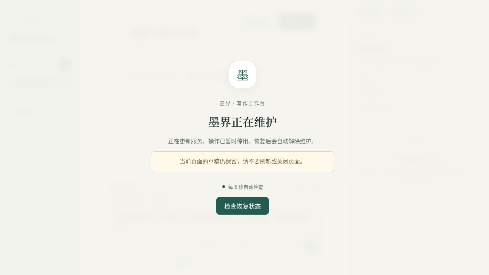
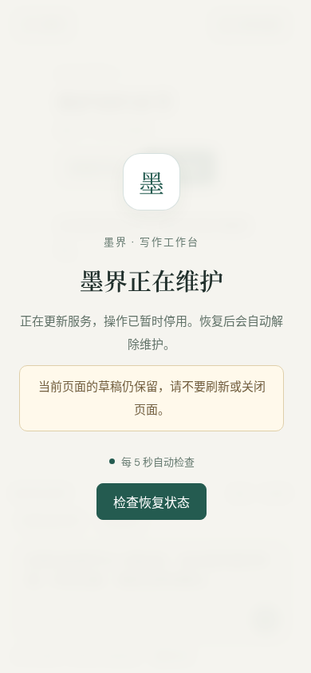

# 安全更新、回退与维护界面验证（2026-10-10）

首版实现已完成本地故障演练和生产接入：本地验证迁移失败及切换后失败能恢复旧环境；生产验证真实 GitHub 发布验签、完整副本更新，以及提交后恢复当前环境保留新增正文。自动更新定时器已启用。安装步骤见 [操作说明](../design/safe-update-operations.md)，保证边界见 [设计方案](../design/safe-update-and-rollback.md)。

## 验证结果

| 验证 | 结果与范围 |
| --- | --- |
| 后端 `mvn verify`，Java 21 / 独立 PostgreSQL 测试库 | 76 个单元测试通过；55 个集成测试中 54 个通过、1 个因未配置执行器 URL 跳过，无失败 |
| 前端单元测试及生产构建 | 61 个测试通过，`npm run build` 成功 |
| 维护模式 Playwright，真实 Java API | 2 个测试通过：保留未保存正文、阻止保存快捷键与 API 写入、Escape 无法关闭维护提示、解除维护后可保存；维护期间新标签页不挂载工作台 |
| 既有浏览器交互回归 | 26 个测试通过，覆盖主页、工作区和建议审阅 |
| Python 部署故障测试 | 13 个测试通过；覆盖各个提交前阶段失败、部署中断恢复、提交后新增数据保留、解锁失败、候选无法停止、失败版本抑制、并发锁、镜像清单约束、独立配置、初始卷检查、入口重载过渡和文件损坏 |
| 真正 Docker / PostgreSQL / Flyway 迁移演练 | 下列 5 项通过；使用临时项目与独立数据卷 |
| 独立入口实测 | 维护页面 GET 与作品创建 POST 均返回 503 / `Retry-After: 5`；写入响应包含 `MAINTENANCE_MODE` |
| 工作流与配置 | `actionlint 1.7.12`、生产 Compose digest 覆盖配置、入口 Compose 配置和 Python 语法检查通过 |

Docker 演练由 [check-safe-deployment.py](../../scripts/check-safe-deployment.py) 执行，机器结果见 [容器演练报告](assets/safe-update-2026-10-10/docker-report.json)，入口响应见 [维护入口报告](assets/safe-update-2026-10-10/gateway-maintenance-report.json)：

1. 独立入口提供维护页面和公开维护状态。
2. 真实 V10 SQL 迁移失败后，回到未被迁移的 V9 环境，正文及旧环境内容摘要一致。
3. 候选健康、实际切换 Nginx 上游后注入失败，恢复旧上游与旧数据。
4. 成功应用 V10，章节正文、Skill 指导和参考文件经恢复及启动后校验仍完整。
5. 在新版本保存新正文，停止当前环境并执行 `recover`，新增正文仍存在。

演练发现并修正了 SELinux Enforcing 下执行协调器无法访问 Docker socket、一次性初始化容器不能作为独立 `--wait` 目标、候选网络名称可能沿用旧项目，以及 Nginx 异步重载期间短暂 502 被立即视为失败的问题。入口检查现在有限重试，并核对实际上游和健康响应；未通过前继续维护。

文件校验同时在恢复完成后及候选启动后执行，后一次允许清理已到期的临时产物；READY Skill 文件及未到期产物仍必须与备份哈希一致。单元测试验证损坏文件会被拒绝，未到期产物不能因缺失而通过。

## 界面证据

已打开页面用原生模态窗口锁住交互，保持编辑器挂载，并提示不要刷新或关闭页面；恢复后返回编辑状态。以下截图经桌面和移动布局检查：





## 复现入口

故障与文件检查：

```bash
python3 -m unittest discover -s scripts -p test_mojie_deploy.py -v
```

浏览器测试使用 Java 21、专用可丢弃测试库和独立维护标记，环境变量示例见 [操作说明](../design/safe-update-operations.md#本地验证)。后端测试库与 Docker 演练的数据库均与现有应用数据隔离。

Docker 演练使用本地构建的以下夹具：

| 镜像 | 夹具内容 |
| --- | --- |
| `mojie-rollback-verify-backend:old` | 本次已构建可执行 JAR，迁移至 V9 |
| `mojie-rollback-verify-backend:bad` | 同一 JAR，额外加入 `BOOT-INF/classes/db/migration/V10__deployment_probe.sql`：先建 `deploy_probe`，再查询不存在的 `intentionally_missing_column`，使真实迁移失败 |
| `mojie-rollback-verify-backend:new` | 同一 JAR，V10 仅执行 `CREATE TABLE deploy_probe(id int);` |
| `mojie-rollback-verify-web:local` | 本次前端生产构建与生产 Nginx 配置 |
| `mojie-rollback-verify-executor:local` | 本次执行协调器镜像 |

准备这些镜像以及 Compose 中固定的运行时镜像后运行：

```bash
python3 scripts/check-safe-deployment.py --output /tmp/mojie-safe-deployment-report.json
```

脚本支持参数指定不同的本地镜像名，并在结束时删除自己生成的容器和数据卷；不清理现有项目。

## 生产接入验收

2026-10-10，经用户授权清空旧生产应用和数据卷，以 `mojie-prod` 初始化空数据库至 V9，保留原有模型设置、Caddy HTTPS 和入口访问控制。原配置及本地修改保存在服务器私有目录 `/var/lib/mojie-deploy/bootstrap-config-20261010T102924Z`；该目录没有旧业务数据库备份，不能用于恢复已清除的旧业务数据。

随后从 `aster-sunfell/mojie` 下载并验证 GitHub Actions run `38043027477`（run number `5`，提交 `36c20b223da85029171443fa812c9b5c78d28f82`）的 `deployment-release` 清单。验签约束仓库、工作流、`main` 分支、源码提交和 GitHub 托管运行器；三个应用镜像均使用清单里的 digest。

| 验证 | 生产结果 |
| --- | --- |
| 首次登记 | 初始 `mojie-prod` 已登记；共享维护标记、独立网关和开机恢复安装完成 |
| 完整更新 | 真实执行维护、排空、冻结、数据库和文件备份、独立候选恢复、启动、摘要及文件校验、上游切换和持久化提交；状态 `COMMITTED`，run number `5` |
| 维护入口 | 首页 GET 和作品创建 POST 均返回 503、`Retry-After: 5`；分别包含维护页和 `MAINTENANCE_MODE` |
| 数据和文件 | 临时测试章节正文、Skill 指导及参考文件更新后仍完整，导出 ZIP 内容核对通过 |
| 提交后恢复 | 在新环境保存新正文，进入维护并停止当前容器后执行 `recover`；新增正文仍存在，恢复后解除维护 |
| 资源清理 | 仅删除本次生成的测试作品、章节和 Skill 活跃资源；备份及保留环境未清理 |
| 自动轮询 | 使用服务器私有凭据实际启动 `mojie-update.service`，结果成功；`mojie-update.timer` 已启用且运行，约每 5 分钟检查发布 |
| 最终状态 | PostgreSQL、后端、执行器、Web 健康；旧环境停止，应用端口仅绑定回环地址；维护已解除 |
| HTTPS 与权限 | 公网 TLS 验证成功，401 和认证响应头符合原有入口保护；Caddy 配置与安装前备份逐字节一致；生产配置和令牌文件权限为 600 |

脱敏机器报告见 [生产验收报告](assets/safe-update-2026-10-10/production-report.json)。生产私有完整记录位于 `/var/lib/mojie-deploy/production-verification-20261010.json`。此次成功更新使用 V9 到 V9 的真实发布；故意失败的 V10 迁移和切换后故障只在上述隔离 Docker 演练中执行，生产没有注入迁移故障。

服务器当前状态应以 `/var/lib/mojie-deploy/state.json` 为准。初始项目保留为 `mojie-prod`；候选环境由程序生成 `mojie-r<run-id>-<attempt>-<随机后缀>` 项目名，保证数据库和文件卷独立。后续运维使用部署程序和 systemd 服务；不要绕过状态记录直接启动保留环境。

## 尚未验证的边界

- 本地故障演练使用夹具镜像；生产另行验证真实发布清单下载与 attestation 验签、完整更新及提交后恢复。生产没有注入迁移失败或切换后故障。
- 未对宿主机实际断电或重启。各个持久化阶段的恢复决策由故障注入测试覆盖，并演练了停止当前容器后的恢复。
- 未验证 PostgreSQL 大版本升级、任意未来业务数据转换或开放写入后的应用降级。首版不会自动恢复旧数据覆盖新版本写入。
- 本地集成测试的 Skill 执行测试有 1 项跳过；Docker 演练覆盖执行器启动及健康状态，未替代完整上传脚本执行验收。

同机备份和副本保护更新过程，异地备份与保留期仍需管理员配置。
